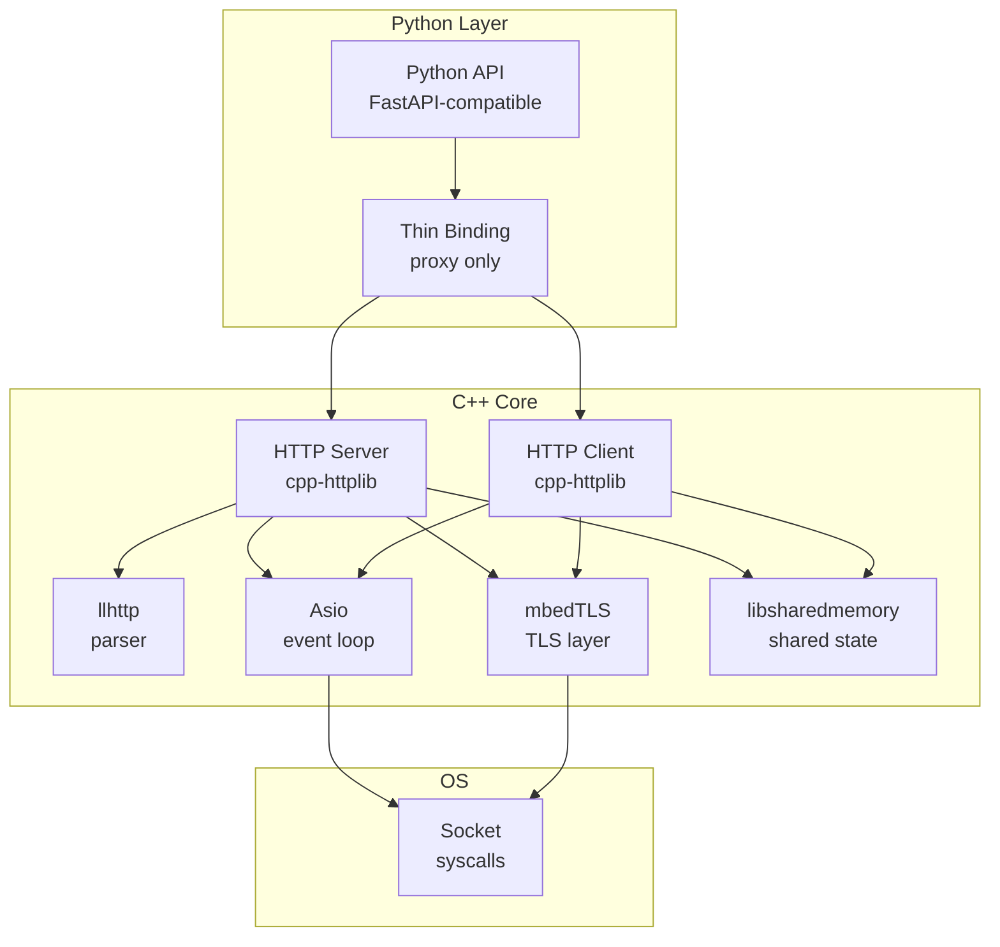
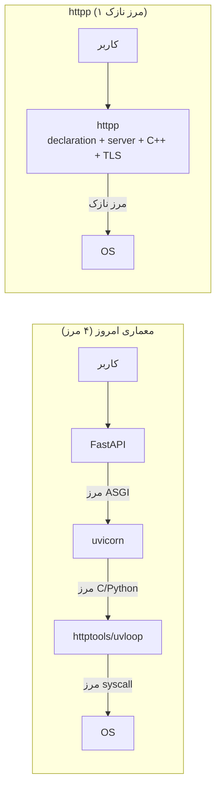
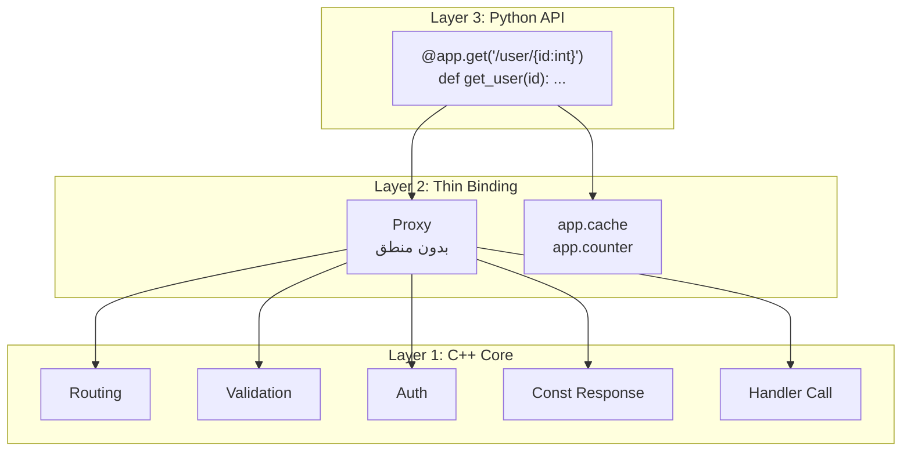
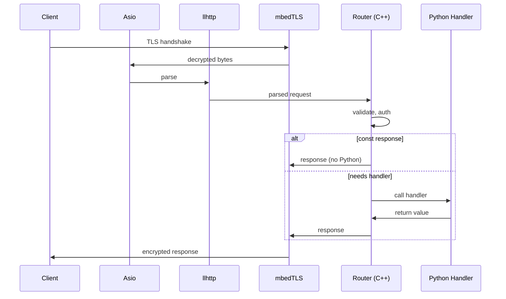
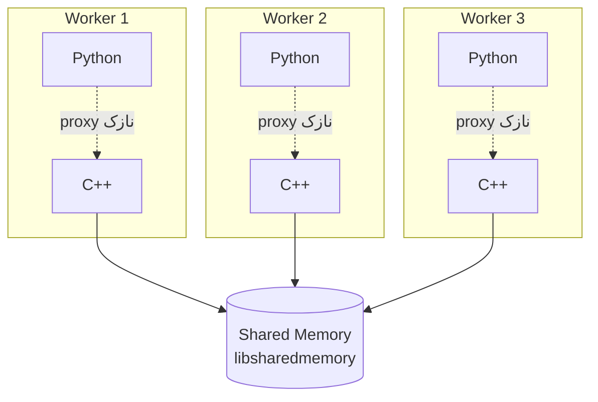

# httpp — Architecture

## ۱. چشم‌انداز

**httpp** یک HTTP stack کامل در C++ است که از **declaration** تا **سوکت** را در یک مالکیت واحد قرار می‌دهد، با یک لایه‌ی نازک پایتونی که API آن با FastAPI سازگار است.

هدف اصلی: **حذف مرزهای لایه‌ای** — نه بهینه‌سازی آن‌ها.

---

## ۲. اهداف

### اهداف اصلی

| # | هدف | معیار موفقیت |
|---|------|--------------|
| ۱ | حذف مرزهای لایه‌ای | از ۴ مرز به ۱ مرز نازک |
| ۲ | drop-in replacement برای FastAPI | `import` عوض شود، بقیه کار کند |
| ۳ | سبکی | چند MB، نه چند ده MB |
| ۴ | zero external dependency | فقط vendored/submodule |
| ۵ | cross-platform | ARM/x86، Windows/Linux/macOS |
| ۶ | shared state شفاف | بدون Redis، بین workerها |

### اهداف غیرهدف (Out of Scope)

- HTTP/2
- HTTP/3 / QUIC
- gRPC
- permessage-deflate (فاز اولیه)
- Proxy (SOCKS، CONNECT)

---

## ۳. زیرساخت

### ماژول‌های C++

| ماژول | نقش | لایسنس | نحوه‌ی استفاده |
|-------|-----|--------|----------------|
| **llhttp** | HTTP/1.1 parser | MIT | submodule |
| **Asio** | async I/O، event loop | Boost | header-only |
| **mbedTLS** | TLS | Apache 2.0 | submodule |
| **cpp-httplib** | HTTP client/server پایه | MIT | header-only |
| **libsharedmemory** | shared state | MIT | header-only |

### نمودار زیرساخت

### نمودار مرزها (قبل و بعد)

---

## ۴. معماری

### لایه‌ها

### جریان درخواست

---

## ۵. اصول طراحی

### اصل ۱ — حذف مرز

هر مرز = هزینه (context switch، کپی، GIL). مرز را **حذف** می‌کنیم، نه بهینه.

### اصل ۲ — پایتون تا جای ممکن بیدار نشه

- const response → C++ جواب می‌دهد
- validation → C++ انجام می‌دهد
- auth → C++ چک می‌کند
- فقط handler واقعی → پایتون

### اصل ۳ — shared memory شفاف

- C++ مدیریت می‌کند
- پایتون از طریق proxy نازک دسترسی دارد
- کاربر نمی‌داند shared memory وجود دارد
- بین workerها یکی است

### اصل ۴ — سبک بمان

- mbedTLS به‌جای OpenSSL
- بدون dependency خارجی
- چند MB، نه چند ده MB

### اصل ۵ — cross-platform

- ARM / x86
- Windows / Linux / macOS
- یک wheel، همه‌جا

---

## ۶. تصمیم‌های طراحی

| تصمیم | انتخاب | چرا | جایگزین رد شده |
|-------|--------|-----|----------------|
| TLS | mbedTLS | سبک، vendored، cross-platform | OpenSSL (سنگین) |
| Parser | llhttp | سریع، بالغ | h11 (پایتون، کند) |
| Event loop | Asio | header-only، کنترل کامل | libuv (dependency) |
| HTTP/2 | ❌ نه | با اهداف در تضاد | — |
| gRPC | ❌ نه | پروتکل جداگانه | — |
| Shared memory | libsharedmemory | header-only، cross-platform | Boost.Interprocess (سنگین) |
| Coupling | tight (درونی) | drop-in replacement | loose (از دست دادن مزیت) |

---

## ۷. نقاط خطر و تصمیم‌گیری

> ⚠️ **هر مورد زیر باید قبل از شروع کد، با کاربر تصمیم‌گیری شود.**

### خطر ۱ — async در multi-core

**مشکل:** `async def` در httpp کندتر از uvicorn است (۱۷.۵k vs ۲۴k). چون دو پرش دارد: Asio → pool → asyncio.

**گزینه‌ها:**

| گزینه | مزیت | هزینه |
|-------|------|-------|
| A. حفظ معماری فعلی | سادگی | کندی async |
| B. حذف پرش دوم | سرعت | پیچیدگی |
| C. async-only | یکنواختی | از دست دادن sync |
| D. sync-only | سرعت | از دست دادن async |

**تصمیم:** _منتظر تصمیم کاربر_

### خطر ۲ — shared memory safety

**مشکل:** مدیریت state در C++ یعنی memory safety کامل روی C++. یک باگ = crash همه‌ی workerها.

**گزینه‌ها:**

| گزینه | مزیت | هزینه |
|-------|------|-------|
| A. libsharedmemory | header-only | کمتر بالغ |
| B. Boost.Interprocess | بالغ | سنگین |
| C. خودمان بنویسیم | کنترل کامل | ریسک بالا |

**تصمیم:** _منتظر تصمیم کاربر_

### خطر ۳ — کوپلینگ درونی

**مشکل:** tight coupling یعنی تغییرات آبشاری، نگهداری سخت‌تر.

**گزینه‌ها:**

| گزینه | مزیت | هزینه |
|-------|------|-------|
| A. tight coupling | حداکثر سرعت | نگهداری سخت |
| B. loose coupling | نگهداری آسان | از دست دادن مزیت |
| C. حالت دوگانه | انعطاف | پیچیدگی |

**تصمیم:** _منتظر تصمیم کاربر_

### خطر ۴ — سازگاری FastAPI

**مشکل:** چقدر باید سازگار باشیم؟ سطح ۱ (import) یا سطح ۴ (اکوسیستم)؟

**گزینه‌ها:**

| گزینه | مزیت | هزینه |
|-------|------|-------|
| A. import-only | سریع | کاربر غافلگیر می‌شود |
| B. API-level | متعادل | کار بیشتر |
| C. ecosystem-level | حداکثر سازگاری | خیلی کار |

**تصمیم:** _منتظر تصمیم کاربر_

### خطر ۵ — cross-platform shared memory

**مشکل:** Windows (`CreateFileMapping`) و Linux (`memfd_create`) متفاوت‌اند.

**گزینه‌ها:**

| گزینه | مزیت | هزینه |
|-------|------|-------|
| A. libsharedmemory | abstraction آماده | کمتر بالغ |
| B. خودمان abstraction | کنترل | هفته‌ها کار |
| C. فقط Linux | سادگی | از دست دادن Windows |

**تصمیم:** _منتظر تصمیم کاربر_

### خطر ۶ — WebSocket backpressure

**مشکل:** اگر client کند باشد، حافظه پر می‌شود (DoS ساده).

**گزینه‌ها:**

| گزینه | مزیت | هزینه |
|-------|------|-------|
| A. bounded queue | امنیت | پیچیدگی |
| B. بدون محدودیت | سادگی | DoS |
| C. فاز اولیه بدون backpressure | سرعت توسعه | ریسک |
