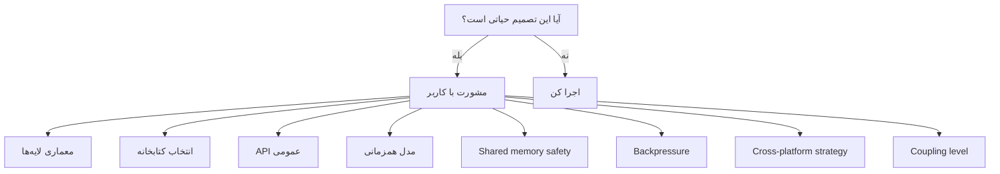
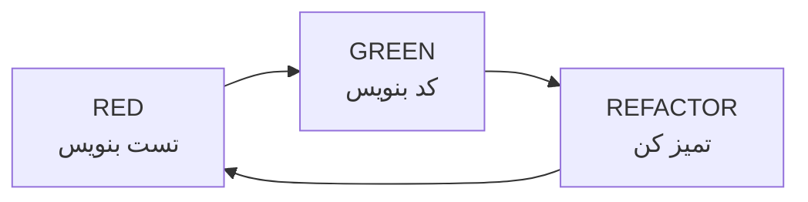
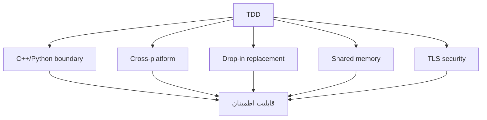

# httpp — Agent Guide

> این فایل راهنمای agent (یا هر توسعه‌دهنده‌ای) است که روی httpp کار می‌کند.

---

## ۱. قانون طلایی — قبل از کد، مشورت

> 🛑 **هیچ تصمیم معماری حیاتی نباید بدون مشورت با کاربر گرفته شود.**

### چه چیزهایی «حیاتی» هستند؟



### لیست تصمیم‌های حیاتی

هر مورد زیر، **قبل از شروع کد** باید با کاربر تصمیم‌گیری شود:

- [ ] تغییر در معماری لایه‌ها
- [ ] انتخاب یا تعویض کتابخانه‌ی C++
- [ ] تغییر در API عمومی پایتون
- [ ] تغییر در مدل همزمانی (sync/async)
- [ ] تصمیم در مورد shared memory safety
- [ ] تصمیم در مورد backpressure
- [ ] تصمیم در مورد cross-platform strategy
- [ ] تصمیم در مورد سطح coupling
- [ ] تصمیم در مورد سطح سازگاری FastAPI
- [ ] هر چیزی که در `Architecture.md` بخش ۷ لیست شده

### فرمت مشورت

وقتی به یک تصمیم حیاتی می‌رسی، این‌طور بپرس:

```
⚠️ تصمیم حیاتی: [عنوان]

مشکل:
[توضیح مشکل]

گزینه‌ها:
1. [گزینه ۱] — مزیت: ... / هزینه: ...
2. [گزینه ۲] — مزیت: ... / هزینه: ...
3. [گزینه ۳] — مزیت: ... / هزینه: ...

پیشنهاد من:
[گزینه پیشنهادی + چرا]

سوال:
کدام گزینه را انتخاب کنیم؟
```

---

## ۲. TDD — تست قبل از کد

### چرخه



**قانون:** هیچ خط کدی بدون تست نوشته نمی‌شود.

### چرا TDD برای httpp حیاتی است



---

## ۳. ساختار تست‌ها

```
tests/
├── unit/           # توابع C++، Python binding
├── integration/    # client + server + TLS
├── compat/         # FastAPI compatibility
├── bench/          # بنچمارک
└── fuzz/           # llhttp, TLS, WebSocket
```

---

## ۴. تست مرز (اول از همه)

### هدف

اندازه‌گیری هزینه‌ی عبور پایتون/C++.

### تست

```python
def test_empty_c_call_overhead():
    """هزینه‌ی یه تماس خالی C++ از پایتون."""
    N = 100_000
    start = time.perf_counter()
    for _ in range(N):
        lib.empty_call()
    elapsed = time.perf_counter() - start
    per_call_us = (elapsed / N) * 1e6
    assert per_call_us < 1.0, f"too slow: {per_call_us}us"
```

### اعداد مرجع

| روش | هزینه (µs) |
|-----|------------|
| ctypes | ۱.۲–۳ |
| cffi ABI | ~۱ |
| cffi API | ۰.۱۵–۰.۲ |
| C extension | ۰.۰۵–۰.۱ |

**هدف:** زیر ۰.۲ µs.

---

## ۵. تست Shared Memory

### تست‌های حیاتی

```python
def test_cache_set_get():
    app.cache["key"] = b"value"
    assert app.cache["key"] == b"value"

def test_cache_shared_across_workers():
    """۵ worker، یه cache."""
    # یه worker می‌نویسد
    # بقیه می‌خوانند
    # باید یکسان باشد

def test_counter_atomic():
    """۱۰۰۰ incr از ۵ worker → باید ۵۰۰۰ شود."""
    # بدون shared memory: هر worker ۱۰۰۰
    # با shared memory: مجموع ۵۰۰۰

def test_crash_recovery():
    """یه worker crash می‌کند، state باید سالم بماند."""
```

### Cross-platform

```python
@pytest.mark.skipif(not is_windows(), reason="Windows only")
def test_shm_windows():
    ...

@pytest.mark.skipif(not is_linux(), reason="Linux only")
def test_shm_linux():
    ...
```

---

## ۶. تست Compatibility (مهم‌ترین)

### هدف

اثبات اینکه httpp **drop-in replacement** است.

### تست

```python
# tests/compat/test_fastapi_suite.py

def test_fastapi_app_runs_on_httpp():
    """یه اپ FastAPI واقعی رو روی httpp اجرا کن."""
    from fastapi import FastAPI
    # ...
```

### عدد بده

```
FastAPI test suite:
- PASS: 450
- FAIL: 50
- SKIP: 20
Compatibility: 90%
```

**این عدد، بخش Evaluation مقاله است.**

---

## ۷. تست Benchmark

```python
def test_benchmark_regression():
    """هر PR نباید کندتر از baseline باشد."""
    baseline = load_baseline("main")
    current = run_benchmark()
    assert current >= baseline * 0.95
```

### CI

- بنچمارک روی هر PR
- مقایسه با main
- اگر افت > ۵٪، fail

---

## ۸. تست Fuzz

### llhttp

```cpp
extern "C" int LLVMFuzzerTestOneInput(const uint8_t* data, size_t size) {
    llhttp_t parser;
    llhttp_init(&parser, HTTP_REQUEST, &settings);
    llhttp_execute(&parser, (const char*)data, size);
    return 0;
}
```

### TLS و WebSocket

- handshake با داده‌ی تصادفی
- certificate بد
- frame بد
- masking اشتباه

---

## ۹. تست امنیت

### Slowloris

```python
def test_slowloris_resistance():
    """اتصال کند نباید سرور را بخواباند."""
    # ۱۰۰۰ اتصال، هر کدام ۱ بایت در ثانیه
    # سرور باید timeout کند
```

### Memory safety

- [ ] AddressSanitizer
- [ ] UndefinedBehaviorSanitizer
- [ ] Valgrind (Linux)

---

## ۱۰. تست Cross-platform

```yaml
strategy:
  matrix:
    os: [ubuntu-latest, windows-latest, macos-latest]
    python: ["3.9", "3.10", "3.11", "3.12", "3.13"]
```

---

## ۱۱. ابزارها

| ابزار | کاربرد |
|-------|--------|
| **pytest** | تست پایتون |
| **GoogleTest** | تست C++ |
| **cibuildwheel** | build wheel |
| **ASan / UBSan** | memory safety |
| **libFuzzer** | fuzz |
| **perf / py-spy** | profiling |
| **wrk / hey** | بنچمارک |

---

## ۱۲. Definition of Done
