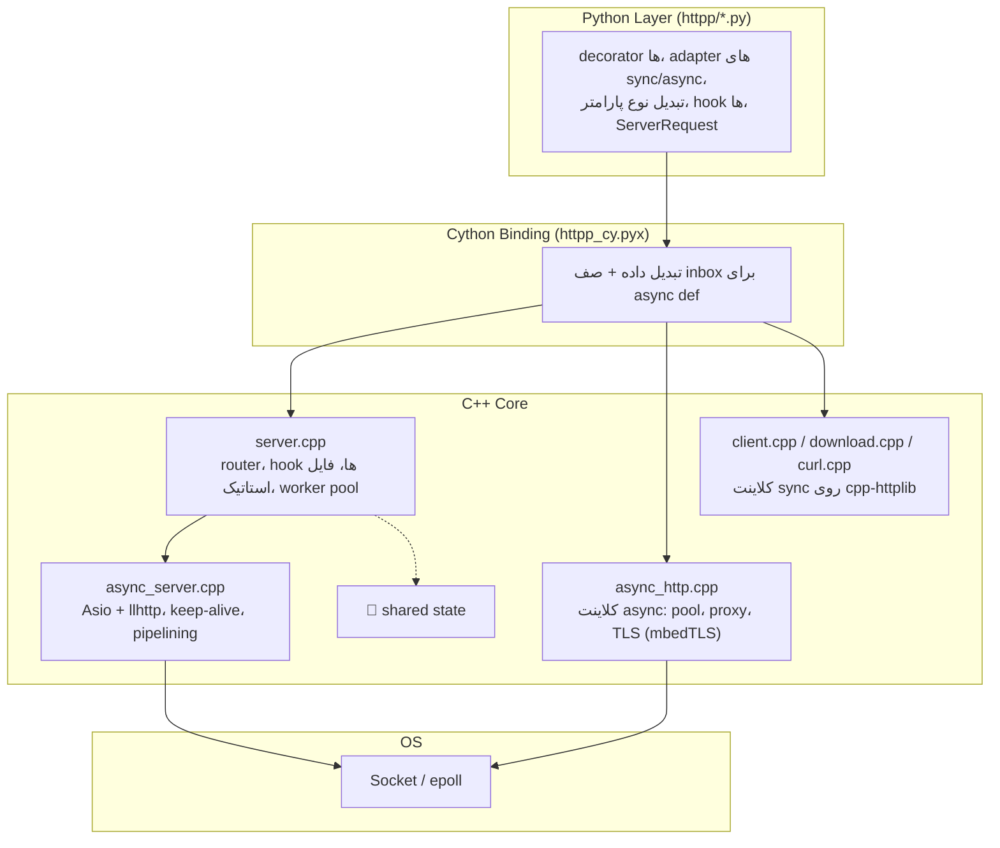
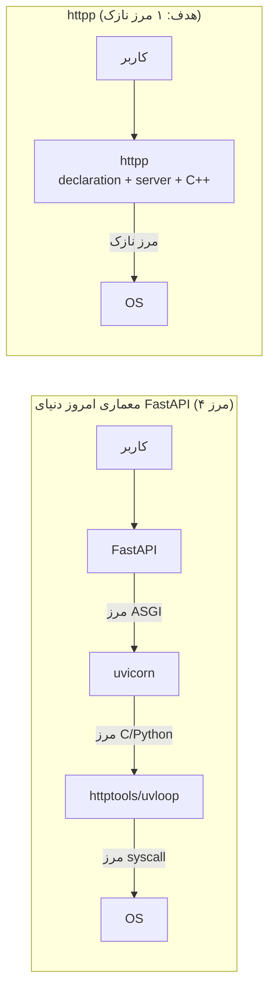
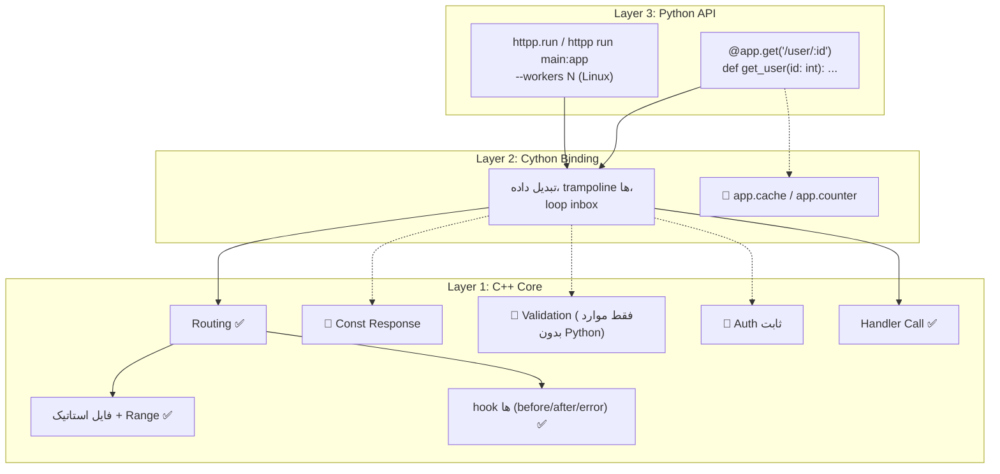
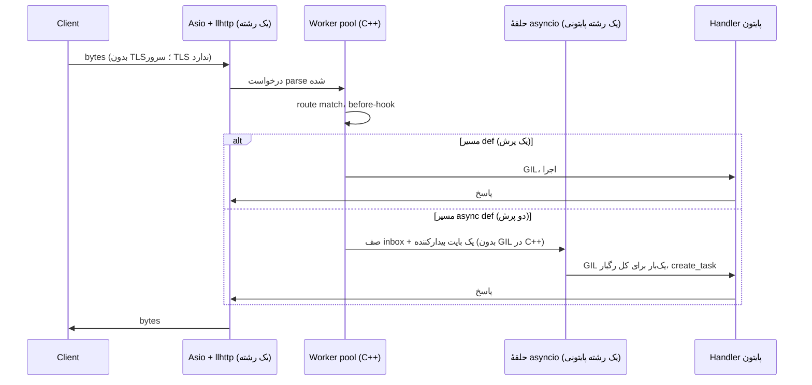
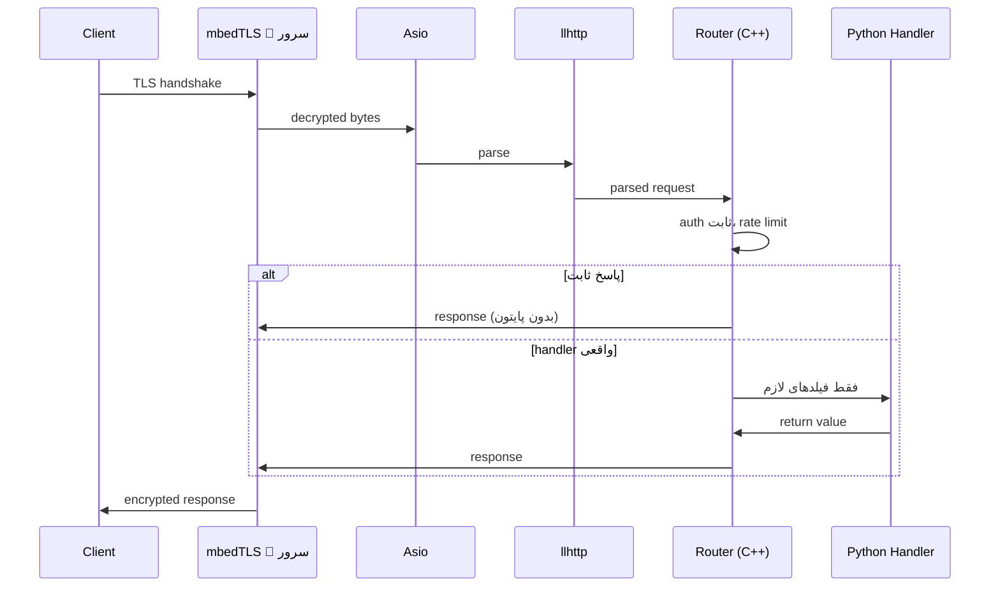
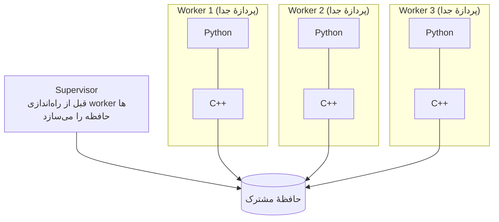

# httpp — Architecture

> وضعیت سند: بازبینی‌شده روی کد واقعی پروژه. هر جا چیزی **هدف** است و هنوز ساخته نشده، با 🎯 علامت خورده؛
> هر جا اندازه‌گیری شده، شرایط اندازه‌گیری کنارش آمده. تصمیم‌های باز در بخش ۷ هستند و **با کاربر** گرفته می‌شوند.

## ۱. چشم‌انداز

**httpp** یک HTTP stack در C++ است که از **declaration** تا **سوکت** را در یک مالکیت واحد قرار می‌دهد،
با یک لایهٔ پایتونی که برنامه‌ها با decorator‌های خودش نوشته می‌شوند (`@app.get(...)`).

هدف اصلی: **حذف مرزهای لایه‌ای** — نه بهینه‌سازی آن‌ها.

> جهت فعلی (تصمیم صاحب پروژه): **httpp هم جای FastAPI/Starlette (بالا) و هم جای uvicorn (پایین) می‌نشیند.**
> API شبیه Starlette (و FastAPI روی آن) به‌صورت بومی پیاده می‌شود و با `httpp run main:app` یا `app.run()` اجرا می‌شود.
> چون هر دو لایه مال ماست، می‌توانیم shared memory، کار اعلامی در C++ و دورشدن از GIL را در کل پشته طراحی کنیم.
> دامنهٔ دقیق API (فقط Starlette-like یا FastAPI-like هم، pydantic) هنوز باز است (خطر ۴).

---

## ۲. اهداف

### اهداف اصلی

| # | هدف | معیار موفقیت | وضعیت فعلی |
|---|------|--------------|------------|
| ۱ | حذف مرزهای لایه‌ای | از ۴ مرز به ۱ مرز نازک | در جریان. مسیر `def`: یک پرش بین رشته‌ها؛ مسیر `async def`: دو پرش (اندازه‌گیری‌شده، بخش ۷ خطر ۱) |
| ۲ | API شبیه Starlette/FastAPI، بومی روی موتور خودمان | تست‌های Starlette و (بعد) FastAPI روی httpp اجرا شوند | **جهت مشخص، دامنه باز (خطر ۴).** بخش بزرگی از API هنوز نیست؛ مسیرها فقط `:name` را می‌فهمند، نه `{name}` |
| ۳ | سبکی | چند MB، نه چند ده MB | ✅ wheel لینوکس حدود **۱٫۱ MB** (شامل mbedTLS) برای `cp39-abi3` و `cp314t` |
| ۴ | zero external dependency | فقط vendored/submodule | ✅ (وابستگی‌های pip **زمان بیلد** مجازند: `jsonschema`، `jinja2`، `cython`) |
| ۵ | cross-platform | ARM/x86، Windows/Linux/macOS | فقط **Linux** اجرا و تأیید شده. کد macOS/Windows نوشته شده ولی هرگز اجرا نشده |
| ۶ | shared state شفاف | بدون Redis، بین workerها | 🎯 شروع نشده |

### اهداف غیرهدف (Out of Scope)

- HTTP/2
- HTTP/3 / QUIC
- gRPC
- permessage-deflate (فاز اولیه)
- **SOCKS proxy** (توجه: پروکسی **HTTP و CONNECT در کلاینت پیاده شده است**؛ فقط SOCKS کنار گذاشته می‌شود)

---

## ۳. زیرساخت

### ماژول‌ها

| ماژول | نقش در httpp | لایسنس | نحوهٔ استفاده |
|-------|--------------|--------|----------------|
| **llhttp** v9.4.3 | parser HTTP/1.1 سرور و کلاینت | MIT | vendored در `src/llhttp` (بدون تغییر) |
| **Asio** (standalone) | event loop و I/O async سرور و کلاینت | Boost Software License | submodule |
| **mbedTLS** | TLS **کلاینت** (سرور هنوز TLS ندارد 🎯) | Apache-2.0 (دولایسنسه با GPL-2.0+) | submodule |
| **liburlparser** | URL | — | submodule |
| **AixLog** | لاگ داخلی | MIT | vendored (یک patch علامت‌گذاری‌شده) |
| **cpp-httplib** v0.54.1 | **فقط** کلاینت sync، `curl.cpp`، `download.cpp`. سرور روی آن **نیست** | MIT | vendored، دست‌نخورده؛ قرار است بازنشسته شود |
| libsharedmemory | **کاندید** برای shared state | MIT | ❌ هنوز انتخاب و vendored نشده (خطر ۲) |

> parser یکسان است: `httptools` (که زیر uvicorn است) هم روی llhttp ساخته شده. پس تفاوت سرعت از parser نمی‌آید.

### نمودار زیرساخت (واقعی، امروز)

### مرزها (قبل و بعد)

---

## ۴. معماری

### لایه‌ها (واقعیت امروز + هدف)

> توجه: لایهٔ پایتونی **نازک نیست**؛ منطق واقعی دارد (تبدیل نوع پارامتر و پاسخ ۴۲۲، adapter‌ها، hook‌ها).
> «proxy بدون منطق» هدف است، نه وضع فعلی.

### جریان درخواست — امروز

### جریان درخواست — هدف 🎯

---

## ۵. اصول طراحی

### اصل ۱ — حذف مرز

هر مرز = هزینه (context switch، کپی، GIL). مرز را **حذف** می‌کنیم، نه بهینه.

### اصل ۲ — پایتون تا جای ممکن بیدار نشه

| کار | وضعیت | یادداشت |
|-----|-------|---------|
| فایل استاتیک | ✅ کامل در C++ | پایتون صدا زده نمی‌شود |
| پاسخ ثابت (`get_const`) | 🎯 | ساده و پرارزش |
| auth با توکن ثابت، CORS، rate limit | 🎯 | هر چیزی که منطق پایتونی لازم ندارد |
| validation نوع پارامتر در C++ | 🎯 ارزش کم | درخواست **معتبر** باز هم به `int` پایتونی نیاز دارد؛ فقط درخواست **نامعتبر** از GIL معاف می‌شود |
| ساختن فقط فیلدهایی که handler خواسته | ✅ | `RawRequest` مشترک با C++ و `ServerRequest` تنبل؛ فقط path param های لازم ساخته می‌شود |

### اصل ۳ — shared memory شفاف 🎯

- C++ مدیریت می‌کند؛ پایتون از طریق proxy نازک دسترسی دارد.
- workerها **پردازهٔ تازه** هستند (نه `fork`): ساختن `Server()` یک epoll fd از Asio می‌سازد که بعد از fork بین پردازه‌ها مشترک می‌شود.
- «شفاف» محدودیت دارد: مقدارها `bytes` یا شمارنده‌اند؛ شیء پایتونی باید صریحاً serialize شود (مثلاً JSON). نباید وانمود کنیم دیکشنری عادی است.

### اصل ۴ — سبک بمان

- mbedTLS به‌جای OpenSSL، بدون dependency خارجی.
- اندازه‌گیری‌شده: wheel حدود ۱٫۱ MB.

### اصل ۵ — cross-platform

- هدف: ARM / x86، Windows / Linux / macOS.
- **«یک wheel برای همه‌جا» درست نیست:** برای هر سیستم‌عامل و معماری یک wheel لازم است. برای پایتون‌های معمولی یک `cp39-abi3` کافی است؛ پایتون free-threaded (3.13t، 3.14t) stable ABI ندارد و **برای هر نسخه** wheel جدا می‌خواهد (`cp313-cp313t`، `cp314-cp314t`). `abi3t` از CPython 3.15 می‌آید.
- امروز فقط Linux واقعاً اجرا شده است.

---

## ۶. تصمیم‌ها

### تصمیم‌های گرفته‌شده

| تصمیم | انتخاب | چرا | جایگزین رد شده |
|-------|--------|-----|----------------|
| TLS | mbedTLS | سبک، vendored، cross-platform | OpenSSL (سنگین) |
| Parser | llhttp | سریع، بالغ | h11 (پایتون، کند) |
| Event loop (I/O) | Asio | کنترل کامل، بدون dependency | libuv (dependency) |
| حلقهٔ handlerهای `async def` | **asyncio استاندارد** | سازگار با httpx، asyncpg، anyio | حلقهٔ asyncio روی Asio (uvloop-style: خیلی سنگین)؛ runner coroutine اختصاصی (با کتابخانه‌های asyncio ناسازگار) |
| چند پردازه (`--workers`) | پردازهٔ تازه + `SO_REUSEPORT`، فقط Linux | `fork` با epoll مشترک امن نیست | fork |
| بسته‌بندی | `cp39-abi3` + wheel جدا برای هر نسخهٔ free-threaded | stable ABI برای 3.13t/3.14t وجود ندارد | — |
| API | **Starlette-like بومی** (FastAPI-like روی آن)، جای FastAPI/Starlette و uvicorn | مالکیت هر دو لایه = حذف مرز و امکان shared memory/کار اعلامی در C++ | اجرای FastAPI آماده روی آداپتور ASGI (مرز را حفظ می‌کند) |
| HTTP/2 | ❌ نه | با اهداف در تضاد | — |
| gRPC | ❌ نه | پروتکل جداگانه | — |

### تصمیم‌های باز (بخش ۷)

| تصمیم | وضعیت |
|-------|-------|
| کتابخانهٔ shared memory | باز (خطر ۲) |
| سطح coupling | باز (خطر ۳) |
| دامنهٔ دقیق API (Starlette-like / FastAPI-like، pydantic) | جهت مشخص، دامنه باز (خطر ۴) |
| مسیر `async def` (حذف پرش) | باز (خطر ۱) |
| backpressure در WebSocket | باز (خطر ۶) |

---

## ۷. نقاط خطر و تصمیم‌گیری

> ⚠️ **هر مورد زیر باید قبل از شروع کد، با کاربر تصمیم‌گیری شود.** «پیشنهاد» فقط پیشنهاد است، نه تصمیم.

### خطر ۱ — سرعت `async def`

**اندازه‌گیری** (یک هستهٔ CPU، handler خالی، یک کلاینت پایتونی یکسان، ۳ دور، پایدار):

| سرور | درخواست بر ثانیه |
|------|------------------|
| uvicorn (httptools + uvloop) | ~۲۴k |
| httpp `def` | ~۲۹k |
| httpp `async def` | ~۱۷٫۵k |

**مشکل:** `async def` حدود ۲۸٪ کندتر از uvicorn است. فرضیه (هنوز اثبات‌نشده): دو پرش بین رشته‌ها
(Asio ← pool ← حلقهٔ asyncio) به‌اضافهٔ نوشتن روی سوکت و بیدارشدن epoll، در حالی که uvicorn همه‌چیز را در یک رشته انجام می‌دهد.
فرضیهٔ «ساختن task» با `eager_task_factory` آزموده شد و **رد شد** (تفاوتی نداشت).
توجه: این اعداد تک‌هسته‌اند و دربارهٔ چندهسته چیزی نمی‌گویند.

**گزینه‌ها:**

| گزینه | مزیت | هزینه |
|-------|------|-------|
| A. حفظ معماری فعلی | سادگی | کندی `async def` نسبت به uvicorn |
| B. حذف پرش دوم: route match روی رشتهٔ Asio و push مستقیم به inbox، وقتی `before_request` نیست | کاهش مستقیم شکاف | بازسازی بخشی از `server.cpp::handle` |
| C. ساختن فقط فیلدهای لازم handler | روی `def` و `async def` اثر دارد | باید hookهای exception (که `request` می‌خواهند) را هم حساب کرد |
| B + C | هر دو | جمع هزینه‌ها |

> «فقط async» یا «فقط sync» که در نسخهٔ قبلی سند بود گزینهٔ واقعی نیست و حذف شد: کاربر هر دو را می‌خواهد.

**پیشنهاد:** B + C، سپس اندازه‌گیری روی ماشین چندهسته‌ای (فاز ۲ در checklist). بدون آن عدد «سبقت از uvicorn» معتبر نیست.

### خطر ۲ — shared memory safety

**مشکل:** مدیریت state در C++ یعنی memory safety کامل روی C++. یک باگ = crash همهٔ workerها.
یک worker هم ممکن است وسط نگه‌داشتن قفل بمیرد.

**دامنه‌ای که باید تصمیم بگیری:** فقط جدول `bytes → bytes` + شمارندهٔ اتمیک (پیشنهاد)، یا چیز غنی‌تر؟

**گزینه‌ها:**

| گزینه | مزیت | هزینه |
|-------|------|-------|
| A. libsharedmemory | header-only، abstraction آماده | بلوغ، نگهداری و پشتیبانی پلتفرم‌ها **هنوز بررسی نشده**؛ باید vendored شود |
| B. Boost.Interprocess | بالغ | سنگین، با هدف «سبک و بدون dependency» تضاد دارد |
| C. پیاده‌سازی خودمان، Linux اول (`memfd_create`/`shm_open` + `mmap` + mutex بین‌پردازه‌ای **robust** + atomic)، پشت یک interface | کنترل کامل؛ robust mutex دقیقاً سناریوی «worker وسط قفل مُرد» (`EOWNERDEAD`) را پوشش می‌دهد؛ بدون dependency | ریسک باگ در کد خودمان؛ Windows (`CreateFileMapping`) بعداً |

**پیشنهاد:** C، با interface که بعداً Windows را بپذیرد؛ با تست چندپردازه‌ای و crash-recovery از روز اول.
**توجه صادقانه:** shared memory **قابلیت** می‌دهد (workers بدون Redis)، نه سرعت خام. جایی که جلوتر از uvicorn+Redis می‌ایستد
بار کاری stateful است (قفل حافظه‌ای در برابر رفت‌وبرگشت شبکه) و هنوز اندازه‌گیری نشده.

### خطر ۳ — کوپلینگ درونی

**مشکل:** tight coupling یعنی تغییرات آبشاری، نگهداری سخت‌تر.
واقعیت امروز: C++ و Cython به هم گره خورده‌اند (trampoline، inbox)، و لایهٔ پایتونی هم منطق دارد.

| گزینه | مزیت | هزینه |
|-------|------|-------|
| A. tight coupling | حداکثر سرعت | نگهداری سخت |
| B. loose coupling | نگهداری آسان | از دست دادن مزیت |
| C. حالت دوگانه | انعطاف | پیچیدگی |

**پیشنهاد:** A برای مسیر داغ درخواست؛ interface‌های روشن فقط روی مرزهای کم‌تکرار (راه‌اندازی، پیکربندی).

### خطر ۴ — دامنهٔ API (Starlette-like / FastAPI-like)

**جهت مشخص است:** API بومی روی موتور خودمان؛ بدون آداپتور ASGI. **سؤال باز:** تا کجا؟
اندازه‌گیری موفقیت: اجرای تست‌های خود Starlette و FastAPI روی httpp (روش در `agent.md` بخش ۶).

| گزینه | شامل | هزینه |
|-------|------|-------|
| A. Starlette-like | `Request`/`Response`، `Router`/`Mount`، middleware، فایل استاتیک، background task، WebSocket، `TestClient` | متوسط تا زیاد؛ بیشترش با موتور فعلی جور است |
| B. A + FastAPI-like | A + نوع پارامتر از annotation، `Depends`، مدل‌های pydantic، OpenAPI | زیاد؛ **pydantic وابستگی اختیاری می‌شود (تصمیم حیاتی: انتخاب کتابخانه)**؛ OpenAPI بزرگ است |
| C. آداپتور ASGI برای اپ‌های ثالث | اجرای FastAPI/Starlette **واقعی** روی موتور ما | مستقل از A و B؛ ترجمهٔ `scope/receive/send` سرعت را محدود می‌کند؛ مرز را برمی‌گرداند |

**پیشنهاد:** A را کامل کن و با تست‌های Starlette اندازه بگیر؛ بعد B به‌تدریج؛ C فقط اگر کاربر بیرونی لازم شد.
یک گام ارزان و بی‌ریسک: پشتیبانی از `{id}` کنار `:id` در router.

> فرق با نسخهٔ قبلی سند: آنجا فرض شده بود «سازگاری» یعنی اجرای اپ FastAPI روی ASGI و با جهت بومی تنش دارد. این غلط بود؛
> مسیر بومی دقیقاً همان جهت است و ASGI فقط یک گزینهٔ جانبی (C) است.

### خطر ۵ — cross-platform shared memory

Windows (`CreateFileMapping`) و Linux (`memfd_create`/`shm_open`) متفاوت‌اند. این خطر **با خطر ۲ یکی تصمیم‌گیری می‌شود.**

| گزینه | مزیت | هزینه |
|-------|------|-------|
| A. libsharedmemory | abstraction آماده | بلوغ بررسی نشده |
| B. abstraction خودمان | کنترل | هفته‌ها کار |
| C. فقط Linux (فعلاً) | سادگی؛ هم‌خوان با وضع `--workers` که امروز فقط Linux است | از دست دادن Windows |

**پیشنهاد:** C فعلاً، پشت interface (همان گزینهٔ C خطر ۲).

### خطر ۶ — WebSocket backpressure

**مشکل:** اگر client کند باشد، حافظه پر می‌شود (DoS ساده). WebSocket هنوز شروع نشده است.

| گزینه | مزیت | هزینه |
|-------|------|-------|
| A. bounded queue | امنیت | پیچیدگی |
| B. بدون محدودیت | سادگی | DoS |
| C. فاز اولیه بدون backpressure | سرعت توسعه | ریسک، و اضافه‌کردنش بعداً سخت‌تر است |

**پیشنهاد:** A از ابتدا.

### خطر ۷ — محدودیت منابع سرور (جدید)

**مشکل:** سقف تعداد اتصال وجود ندارد (فقط backoff وقتی fd تمام می‌شود) و محدودیت درخواست‌های کند (slowloris) هم نیست.
این مهم‌ترین مورد امنیتی است و تست slowloris در `agent.md` تا آن موقع **باید رد شود**.
**پیشنهاد:** `set_max_connections`، timeout هدر، و timeout هر route، قبل از WebSocket.

### خطر ۸ — پایتون free-threaded (جدید)

**مشکل:** روی 3.13t/3.14t، handlerهای `def` روی رشته‌های pool واقعاً موازی‌اند و dict و شمارندهٔ سراسری کاربر همزمان لمس می‌شوند.
بدون اعلام `freethreading_compatible` مفسر هنگام import، GIL را دوباره روشن می‌کند (اثبات‌شده؛ اعلام اضافه شده).
تأیید شده: کل تست‌های پایتون و یک استرس‌تست روی 3.14t با GIL خاموش، **روی یک هسته**. تسریع چندهسته‌ای اندازه‌گیری نشده.
**پیشنهاد:** بنچمارک چندهسته‌ای قبل از هر ادعا؛ مستندکردن thread-safety برای کاربر.
