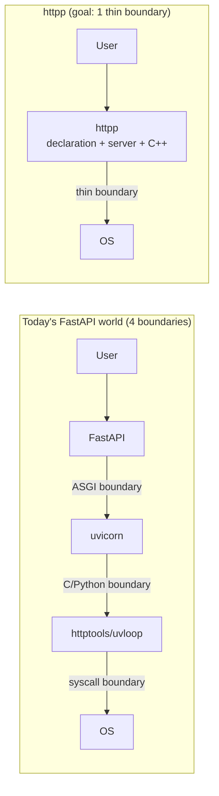
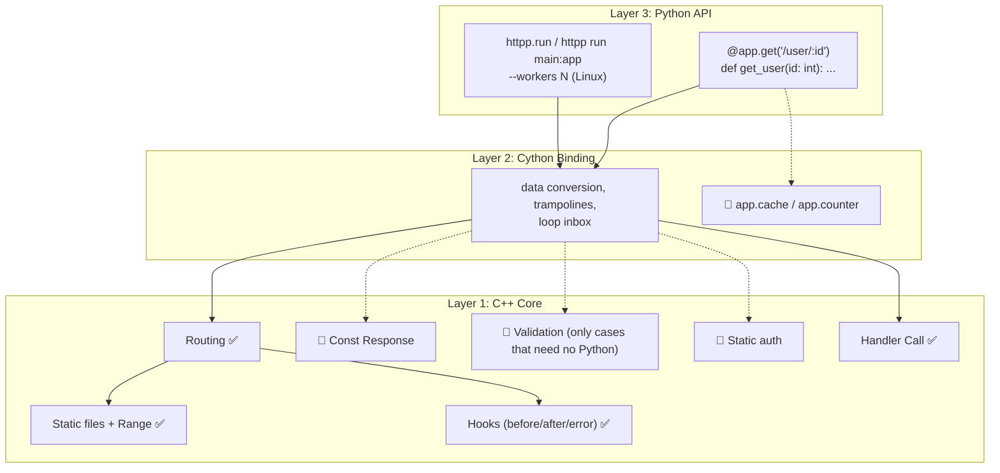
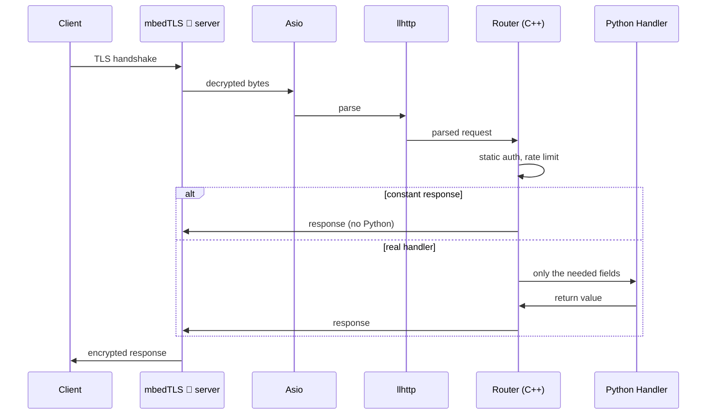
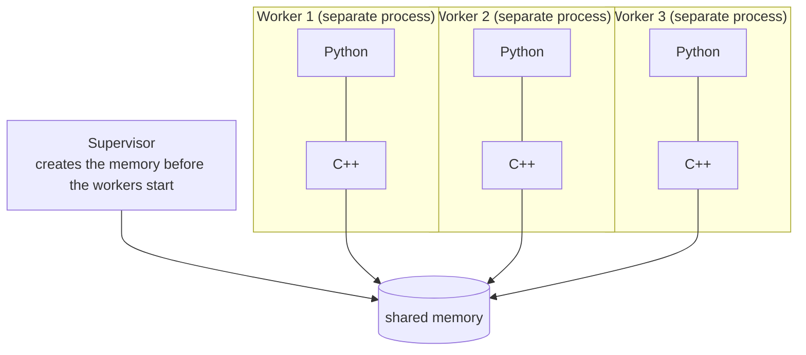

# httpp: Architecture

> Document status: reviewed against the real code. Anything that is a **goal** and not built yet is marked with 🎯.
> Anything that was measured says under which conditions. Open decisions are in section 7 and are made **with the project owner**.
> Accepted decisions are recorded one by one in [docs/adr](adr/README.md).

## 1. Vision

**httpp** is a C++ HTTP stack that puts everything from the **declaration** down to the **socket** under one owner,
with a Python layer in which applications are written with its own decorators (`@app.get(...)`).

The main goal: **remove the layer boundaries**, not optimize them.

> Current direction (decided by the project owner): **httpp replaces FastAPI/Starlette (above) and uvicorn (below).**
> A Starlette-like API (with FastAPI on top of it) is implemented natively and started with `httpp run main:app` or `app.run()`.
> Because both layers are ours, shared memory, declarative work in C++ and getting away from the GIL can be designed across the whole stack.
> The exact scope of the API (Starlette-like only, or FastAPI-like as well, pydantic) is still open (risk 4).

---

## 2. Goals

### Main goals

| # | Goal | Success criterion | Current status |
|---|------|-------------------|----------------|
| 1 | Remove layer boundaries | From 4 boundaries to 1 thin boundary | In progress. `def` path: one thread hop. `async def` path: see [ADR-0009](adr/0009-hot-path.md) and risk 1 |
| 2 | Starlette/FastAPI-like API, native on our own engine | Starlette's and (later) FastAPI's tests run on httpp | **Direction set, scope open (risk 4).** A large part of the API is still missing. The C++ router understands only `:name`; the Python layer also accepts `{name}` and `<name>` |
| 3 | Lightweight | A few MB, not tens of MB | ✅ the Linux wheel is about **1.8 MB** (0.7.0, includes mbedTLS and the Swagger UI bundle, measured with `pip-size`) |
| 4 | Zero external dependencies | Only vendored files or submodules | ✅ (pip dependencies are allowed at **build time**: `scikit-build-core`, `cython`, `cython-cmake`, `jsonschema`, `jinja2`) |
| 5 | Cross-platform | ARM/x86, Windows/Linux/macOS | ✅ built and tested in CI on Linux, macOS and Windows (C++ tests run on Linux and macOS; the Python tests run inside every wheel on all three). See [ADR-0015](adr/0015-testing-and-ci.md) |
| 6 | Transparent shared state | No Redis, across workers | 🎯 not started |

### Non-goals (out of scope)

- HTTP/2
- HTTP/3 / QUIC
- gRPC
- permessage-deflate (initial phase)
- **SOCKS proxy** (note: **HTTP and CONNECT proxies are implemented in the client**; only SOCKS is left out)

---

## 3. Infrastructure

### Modules

| Module | Role in httpp | License | How it is used |
|--------|---------------|---------|----------------|
| **llhttp** v9.4.3 | HTTP/1.1 parser for server and client | MIT | vendored in `src/llhttp` (unmodified) |
| **Asio** (standalone) | event loop and async I/O for server and client | Boost Software License | submodule |
| **mbedTLS** | TLS for the **client** (the server has no TLS yet 🎯) | Apache-2.0 (dual-licensed with GPL-2.0+) | submodule |
| **liburlparser** | URLs | n/a | submodule |
| **AixLog** | internal logging | MIT | vendored (one marked patch) |
| **cpp-httplib** v0.54.1 | **only** the sync client, `curl.cpp`, `download.cpp`. The server does **not** run on it | MIT | vendored, untouched; to be retired |
| libsharedmemory | **candidate** for shared state | MIT | ❌ not chosen or vendored yet (risk 2) |

> The parser is the same one: `httptools` (which sits under uvicorn) is also built on llhttp. So the speed difference does not come from the parser.

### Infrastructure diagram (real, today)


### Boundaries (before and after)



---

## 4. Architecture

### Layers (today's reality + goal)



> Note: the Python layer is **not thin**. It has real logic (parameter type conversion and the 422 response, adapters, hooks).
> A "proxy without logic" is a goal, not the current state.

### Request flow, today

```mermaid
sequenceDiagram
    participant C as Client
    participant A as Asio + llhttp (one thread)
    participant W as Worker pool (C++)
    participant L as asyncio loop (one Python thread)
    participant P as Python handler

    C->>A: bytes (no TLS; the server has no TLS)
    A->>W: parsed request
    W->>W: route match, before-hook
    alt def route (one hop)
        W->>P: GIL, run
        P->>A: response
    else async def route
        W->>L: inbox queue + one wake-up byte (no GIL in C++)
        L->>P: GIL once for the whole burst, create_task
        P->>A: response
    end
    A->>C: bytes
```

### Request flow, goal 🎯



---

## 5. Design principles

### Principle 1: remove the boundary

Every boundary costs something (context switch, copy, GIL). We **remove** the boundary, we do not optimize it.

### Principle 2: wake Python as little as possible

| Work | Status | Notes |
|------|--------|-------|
| Static files | ✅ fully in C++ | Python is never called |
| Constant response (`get_const`) | 🎯 | simple and valuable |
| Static-token auth, CORS, rate limit | 🎯 | anything that needs no Python logic |
| Parameter type validation in C++ | 🎯 low value | a **valid** request still needs a Python `int`; only an **invalid** request avoids the GIL |
| Build only the fields the handler asked for | ✅ | `RawRequest` shared with C++ and a lazy `ServerRequest`; only the needed path params are built |

### Principle 3: transparent shared memory 🎯



- C++ manages it; Python reaches it through a thin proxy.
- Workers are **fresh processes** (not `fork`): creating a `Server()` creates an Asio epoll fd that would be shared between processes after a fork.
- "Transparent" has limits: values are `bytes` or counters; a Python object has to be serialized explicitly (for example as JSON). We must not pretend it is an ordinary dict.

### Principle 4: stay light

- mbedTLS instead of OpenSSL, no external dependency.
- Measured: the wheel is about 1.8 MB.

### Principle 5: cross-platform

- Goal: ARM / x86, Windows / Linux / macOS.
- **"One wheel for everywhere" is wrong:** one wheel per operating system and architecture is needed. For ordinary Pythons one `cp39-abi3` is enough; free-threaded Python (3.13t, 3.14t, 3.15t) has no stable ABI and needs a **separate wheel for each version** (`cp313t`, `cp314t`, `cp315t`). `abi3t` arrives with CPython 3.15.
- CI builds and tests the wheels on Linux, macOS and Windows ([ADR-0013](adr/0013-packaging.md)).

---

## 6. Decisions

### Decisions made

Each one has an ADR with context, rejected alternatives and consequences: [docs/adr](adr/README.md).

| Decision | Choice | Why | Rejected alternative |
|----------|--------|-----|----------------------|
| TLS | mbedTLS | light, vendored, cross-platform | OpenSSL (heavy) |
| Parser | llhttp | fast, mature | h11 (Python, slow) |
| Event loop (I/O) | Asio | full control, no dependency | libuv (a dependency) |
| Loop for `async def` handlers | **standard asyncio** | compatible with httpx, asyncpg, anyio | asyncio loop on Asio (uvloop-style: far too heavy); a custom coroutine runner (incompatible with asyncio libraries) |
| Multi-process (`--workers`) | fresh processes + `SO_REUSEPORT`, Linux only | `fork` with a shared epoll is not safe | fork |
| Packaging | `cp39-abi3` + a separate wheel per free-threaded version | no stable ABI for 3.13t/3.14t/3.15t | n/a |
| API | **native Starlette-like** (FastAPI-like on top), replacing FastAPI/Starlette and uvicorn | owning both layers = no boundary and room for shared memory and declarative work in C++ | running stock FastAPI on an ASGI adapter (keeps the boundary) |
| HTTP/2 | ❌ no | conflicts with the goals | n/a |
| gRPC | ❌ no | a separate protocol | n/a |

### Open decisions (section 7)

| Decision | Status |
|----------|--------|
| Shared memory library | open (risk 2) |
| Coupling level | open (risk 3) |
| Exact API scope (Starlette-like / FastAPI-like, pydantic) | direction set, scope open (risk 4) |
| `async def` path (removing the hop) | partly done, see [ADR-0009](adr/0009-hot-path.md) (risk 1) |
| Backpressure in WebSocket | open (risk 6) |

---

## 7. Risks and decision points

> ⚠️ **Each item below must be decided with the project owner before any code is started.** A "suggestion" is only a suggestion, not a decision.

### Risk 1: `async def` speed

**Measurement at the time of writing** (one CPU core, empty handler, the same Python client, 3 rounds, stable):

| Server | Requests per second |
|--------|---------------------|
| uvicorn (httptools + uvloop) | ~24k |
| httpp `def` | ~29k |
| httpp `async def` | ~17.5k |

**Problem:** `async def` was about 28% slower than uvicorn. Hypothesis (not proven): two thread hops
(Asio, then the pool, then the asyncio loop) plus the socket write and the epoll wake-up, while uvicorn does everything in one thread.
The "task creation" hypothesis was tested with `eager_task_factory` and **rejected** (it made no difference).
Note: these numbers are single-core and say nothing about multi-core.

**Options:**

| Option | Advantage | Cost |
|--------|-----------|------|
| A. Keep the current architecture | simplicity | `async def` is slower than uvicorn |
| B. Remove the second hop: route match on the Asio thread and a direct push into the inbox, when there is no `before_request` | directly reduces the gap | rebuilds part of `server.cpp::handle` |
| C. Build only the fields the handler needs | helps both `def` and `async def` | exception hooks (which want `request`) have to be accounted for |
| B + C | both | the sum of the costs |

> "Async only" or "sync only", which were in the previous version of this document, are not real options and were removed: the project owner wants both.

**Suggestion:** B + C, then measure on a multi-core machine. Without that number a claim of "faster than uvicorn" is not valid.

**Status:** B + C were chosen and built (see [ADR-0009](adr/0009-hot-path.md)). On one core, with the server and the load generator sharing it, `async def` reached about 33k requests per second against 23k for uvicorn on `hello`, and `def` and `async def` are within noise on `item`. **There is still no multi-core measurement.**

### Risk 2: shared memory safety

**Problem:** managing state in C++ means full memory safety in C++. One bug = all workers crash.
A worker can also die while holding a lock.

**Scope you must decide:** only a `bytes → bytes` table plus an atomic counter (suggested), or something richer?

**Options:**

| Option | Advantage | Cost |
|--------|-----------|------|
| A. libsharedmemory | header-only, ready-made abstraction | maturity, maintenance and platform support **not reviewed yet**; must be vendored |
| B. Boost.Interprocess | mature | heavy, conflicts with the "light and dependency-free" goal |
| C. Our own implementation, Linux first (`memfd_create`/`shm_open` + `mmap` + a **robust** inter-process mutex + atomics), behind an interface | full control; a robust mutex covers exactly the "worker died holding the lock" scenario (`EOWNERDEAD`); no dependency | risk of bugs in our own code; Windows (`CreateFileMapping`) later |

**Suggestion:** C, with an interface that can accept Windows later; with multi-process and crash-recovery tests from day one.
**Honest note:** shared memory gives a **capability** (workers without Redis), not raw speed. Where it can pull ahead of uvicorn + Redis
is a stateful workload (an in-memory lock against a network round trip), and that has not been measured yet.

### Risk 3: internal coupling

**Problem:** tight coupling means cascading changes and harder maintenance.
Reality today: C++ and Cython are tied together (trampolines, inbox), and the Python layer also has logic.

| Option | Advantage | Cost |
|--------|-----------|------|
| A. Tight coupling | maximum speed | hard to maintain |
| B. Loose coupling | easy to maintain | loses the advantage |
| C. Dual mode | flexibility | complexity |

**Suggestion:** A for the hot request path; clear interfaces only on rarely repeated boundaries (startup, configuration).

### Risk 4: API scope (Starlette-like / FastAPI-like)

**The direction is set:** a native API on our own engine, with no ASGI adapter. **Open question:** how far?
Success measure: running Starlette's and FastAPI's own tests on httpp (method in `agent.md`, section 6).

| Option | Includes | Cost |
|--------|----------|------|
| A. Starlette-like | `Request`/`Response`, `Router`/`Mount`, middleware, static files, background tasks, WebSocket, `TestClient` | medium to high; most of it fits the current engine |
| B. A + FastAPI-like | A + parameter types from annotations, `Depends`, pydantic models, OpenAPI | high; **pydantic becomes an optional dependency (critical decision: choice of library)**; OpenAPI is large |
| C. ASGI adapter for third-party apps | running **real** FastAPI/Starlette on our engine | independent of A and B; translating `scope/receive/send` limits speed; brings the boundary back |

**Suggestion:** finish A and measure with Starlette's tests; then B step by step; C only if an outside user needs it.
One cheap, risk-free step: support `{id}` next to `:id` in the router.

> Difference from the previous version of this document: it assumed that "compatibility" meant running a FastAPI app on ASGI and clashed with the native direction. That was wrong;
> the native path is exactly the direction and ASGI is only a side option (C).

### Risk 5: cross-platform shared memory

Windows (`CreateFileMapping`) and Linux (`memfd_create`/`shm_open`) differ. This risk is **decided together with risk 2.**

| Option | Advantage | Cost |
|--------|-----------|------|
| A. libsharedmemory | ready-made abstraction | maturity not reviewed |
| B. Our own abstraction | control | weeks of work |
| C. Linux only (for now) | simplicity; matches `--workers`, which is Linux only today | loses Windows |

**Suggestion:** C for now, behind an interface (the same as option C of risk 2).

### Risk 6: WebSocket backpressure

**Problem:** with a slow client, memory fills up (a simple DoS). WebSocket has not been started yet.

| Option | Advantage | Cost |
|--------|-----------|------|
| A. Bounded queue | safety | complexity |
| B. No limit | simplicity | DoS |
| C. No backpressure in the initial phase | development speed | risk, and adding it later is harder |

**Suggestion:** A from the start.

### Risk 7: server resource limits (new)

**Problem:** there is no cap on the number of connections (only a backoff when fds run out) and no limit on slow requests (slowloris).
This is the most important security item, and the slowloris test in `agent.md` **must fail** until it is done.
**Suggestion:** `set_max_connections`, a header timeout and a per-route timeout, before WebSocket.

### Risk 8: free-threaded Python (new)

**Problem:** on 3.13t/3.14t/3.15t, `def` handlers on the pool threads are truly parallel and the user's global dicts and counters are touched at the same time.
Without declaring `freethreading_compatible`, the interpreter turns the GIL back on at import (proven; the declaration was added).
CI runs a test that checks the GIL stays off on the free-threaded wheels; the whole Python test suite and a stress test were also run on 3.14t with the GIL off, **on one core**. Multi-core speed-up has not been measured.
**Suggestion:** a multi-core benchmark before any claim; document thread safety for users.
