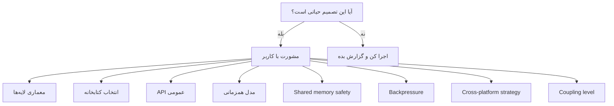
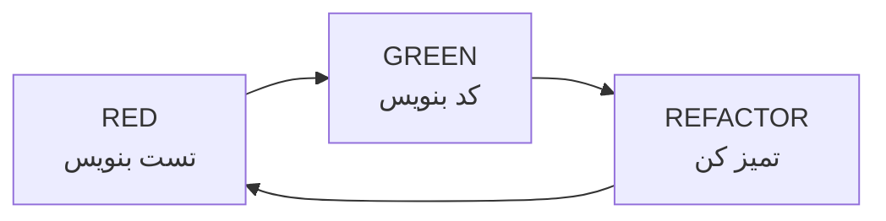
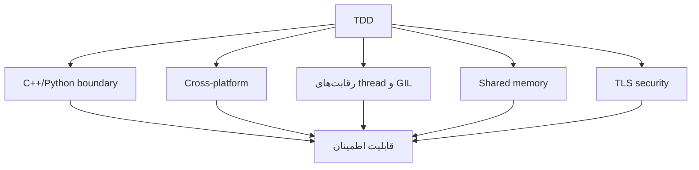

# httpp — Agent Guide

> این فایل راهنمای agent (یا هر توسعه‌دهنده‌ای) است که روی httpp کار می‌کند.
> زبان گزارش به کاربر: **فارسی**. قوانین سخت پروژه (بدون وابستگی سیستمی، `snake_case`، سبک ponytail،
> cpp-httplib دست‌نخورده) در `handoff.md` است و اینجا تکرار نمی‌شود.

---

## ۱. قانون طلایی — قبل از کد، مشورت

> 🛑 **هیچ تصمیم معماری حیاتی نباید بدون مشورت با کاربر گرفته شود.**

اما **هر قدم کوچک نیاز به اجازه ندارد.** وقتی اولویت بعدی مشخص و حیاتی نیست، انجامش بده و بعد گزارش بده.
هر انتخابی که کردی را با دلیلش گزارش کن.

### چه چیزهایی «حیاتی» هستند؟



### لیست تصمیم‌های حیاتی

هر مورد زیر، **قبل از شروع کد** باید با کاربر تصمیم‌گیری شود:

- [ ] تغییر در معماری لایه‌ها
- [ ] انتخاب یا تعویض کتابخانهٔ C++ (و هر dependency جدید: باید vendored یا submodule باشد)
- [ ] تغییر در API عمومی پایتون
- [ ] تغییر در مدل همزمانی (sync/async)
- [ ] تصمیم در مورد shared memory safety
- [ ] تصمیم در مورد backpressure
- [ ] تصمیم در مورد cross-platform strategy
- [ ] تصمیم در مورد سطح coupling
- [ ] تصمیم در مورد سطح سازگاری FastAPI
- [ ] هر چیزی که در `Architecture.md` بخش ۷ لیست شده

### تصمیم‌های گرفته‌شده (دوباره باز نکن)

- **جهت API:** API شبیه Starlette (و FastAPI روی آن) به‌صورت **بومی** در httpp. httpp هم جای FastAPI/Starlette (بالا) و هم جای uvicorn (پایین) می‌نشیند و چون هر دو لایه مال ماست، از آن برای shared memory، کار اعلامی در C++ و دورشدن از GIL استفاده می‌کنیم. آداپتور ASGI فقط برای اجرای اپ‌های ASGI **ثالث** است و کم‌اولویت. دامنهٔ دقیق (فقط Starlette-like یا FastAPI-like هم، pydantic) هنوز باز است (`Architecture.md` خطر ۴).
- حلقهٔ handlerهای `async def`: **asyncio استاندارد.** حلقهٔ asyncio روی Asio و runner coroutine اختصاصی رد شده‌اند.
- `--workers`: پردازهٔ تازه با `SO_REUSEPORT` (فقط Linux)، نه `fork`.
- wheel: یک `cp39-abi3` برای پایتون‌های معمولی + wheel جدا برای هر نسخهٔ free-threaded.
- HTTP/2 و gRPC خارج از دامنه‌اند.

### فرمت مشورت

وقتی به یک تصمیم حیاتی می‌رسی، این‌طور بپرس:

```
⚠️ تصمیم حیاتی: [عنوان]

مشکل:
[توضیح مشکل]

گزینه‌ها:
1. [گزینه ۱] — مزیت: ... / هزینه: ...
2. [گزینه ۲] — مزیت: ... / هزینه: ...
3. [گزینه ۳] — مزیت: ... / هزینه: ...

پیشنهاد من:
[گزینهٔ پیشنهادی + چرا]

سوال:
کدام گزینه را انتخاب کنیم؟
```

### قبل از ادعای عملکرد

هر ادعای سرعت باید با **شرایط اندازه‌گیری** گزارش شود (تعداد هسته، handler، کلاینت، تعداد دور).
اندازه‌گیری روی یک هسته چیزی دربارهٔ چندهسته نمی‌گوید؛ این را همیشه صریح بنویس.

---

## ۲. TDD — تست قبل از کد

### چرخه



**قانون:** هیچ خط کد رفتاری بدون تست نوشته نمی‌شود. (مستندات و پیکربندی بیلد مستثنا هستند.)

اگر تست باید «باید رد شود» باشد (مثل slowloris قبل از وجود سقف اتصال)، آن را صریحاً به‌عنوان
**شکست انتظاری** علامت بزن و در گزارش بنویس، نه اینکه ساکت بگذاری.

### چرا TDD برای httpp حیاتی است



---

## ۳. ساختار تست‌ها

**امروز:**

```
tests/
├── cpp/        # utest (tests/utest)؛ تست‌های موتور، سرور، کلاینت، TLS، URL، لاگ
├── python/     # pytest؛ شامل test_run.py (CLI، سیگنال‌ها، workers) و test_server_features.py
└── utest/      # چارچوب تست C++ (vendored)
```

**هدف** (فقط وقتی لازم شد، بدون ساختن پوشهٔ خالی):

```
tests/
├── bench/      # بنچمارک
├── fuzz/       # سطح parse و محدودیت‌های خودمان
└── compat/     # فقط اگر سطح FastAPI (خطر ۴) آداپتور ASGI را لازم کرد
```

---

## ۴. تست مرز (اول از همه)

### هدف

اندازه‌گیری هزینهٔ عبور پایتون/C++ **در binding خودمان** (Cython)، و تعداد عبور در هر درخواست.

### تست

برای اندازه‌گیری یک تماس خالی، یک تابع noop فقط برای بنچمارک در binding لازم است (کار کوچک، با مشورت).

```python
def test_empty_c_call_overhead():
    """هزینهٔ یه تماس خالی C++ از پایتون: فقط گزارش کن."""
    N = 1_000_000
    start = time.perf_counter()
    for _ in range(N):
        _bench_noop()
    per_call_us = (time.perf_counter() - start) / N * 1e6
    print(f"empty call: {per_call_us:.3f} us")  # عدد را ثبت کن؛ آستانه را بعد از دانستن baseline بگذار
```

> نسخهٔ قبلی سند هم `assert < 1.0` داشت و هم «هدف زیر ۰٫۲» را گفته بود؛ این دو ناسازگار بودند.
> تا baseline اندازه‌گیری نشده، آستانهٔ ثابت نگذار.

### اعداد مرجع (تقریبی، **تأییدنشده**؛ باید اندازه‌گیری شوند)

| روش | هزینه (µs) |
|-----|------------|
| ctypes | ~۱–۳ |
| cffi ABI | ~۱ |
| cffi API | ~۰٫۱–۰٫۲ |
| C extension / Cython | ~۰٫۰۵–۰٫۱ |

مقایسهٔ ctypes/cffi/pybind11 فقط برای مقاله ارزش دارد؛ پروژه روی Cython است.

---

## ۵. تست Shared Memory

> ⚠️ قبل از شروع، تصمیم safety (خطر ۲) گرفته شود. **Linux اول.**

### تست‌های حیاتی

```python
import sys
import pytest

linux_only = pytest.mark.skipif(not sys.platform.startswith("linux"), reason="Linux only")
windows_only = pytest.mark.skipif(sys.platform != "win32", reason="Windows only")

def test_cache_set_get():
    app.cache["key"] = b"value"
    assert app.cache["key"] == b"value"

@linux_only
def test_cache_shared_across_workers():
    """۵ worker، یه cache: یکی می‌نویسد، بقیه می‌خوانند."""

@linux_only
def test_counter_atomic():
    """۱۰۰۰ incr از ۵ worker → باید ۵۰۰۰ شود (بدون shared memory: هر worker ۱۰۰۰)."""

@linux_only
def test_crash_recovery():
    """یه worker وسط نگه‌داشتن قفل بمیرد (SIGKILL): بقیه نباید قفل شوند و state باید سالم بماند."""
```

برای راه‌اندازی workerها همان الگوی `tests/python/test_run.py` را بخوان (پردازه‌های `python -m httpp run`
با `PYTHONPATH` محاسبه‌شده از `httpp.__file__`).

---

## ۶. تست Compatibility

> ⚠️ دامنهٔ دقیق API (خطر ۴) قبل از شروع با کاربر تصمیم‌گیری شود.

### هدف

اثبات اینکه API بومیِ شبیه Starlette/FastAPI که روی موتور خودمان ساخته‌ایم، واقعاً رفتار آن‌ها را دارد،
با **اجرای تست‌های خودِ آن‌ها** روی httpp. **آداپتور ASGI لازم نیست:** ما کتابخانه را دوباره پیاده می‌کنیم،
نه اینکه آن را روی سرورمان اجرا کنیم.

> نسخهٔ قبلی این بخش می‌گفت «تست‌های FastAPI بدون سرور اجرا می‌شوند، پس آداپتور ASGI می‌خواهد». آن حرف فقط
> برای اجرای یک اپ FastAPI **آماده** روی httpp درست است و برای مسیر ما غلط بود؛ اصلاح شد.

### روش

1. **اول Starlette، بعد FastAPI.** مجموعه‌تست Starlette کوچک‌تر و در سطح فریم‌ورک است (routing، request/response،
   middleware، فایل استاتیک، background task، websocket)، که دقیقاً لایه‌ای است که می‌سازیم. FastAPI روی آن می‌نشیند.
2. تست‌ها را **در CI در نسخهٔ مشخص (tag) کلون کن**، نه اینکه در مخزن کپی شوند (لایسنس‌ها: Starlette BSD-3، FastAPI MIT).
   وابستگی‌های `starlette`، `fastapi`، `httpx`، `pydantic` فقط **وابستگی تست** هستند، نه وابستگی httpp.
3. importها را با یک shim عوض کن (مثلاً در `conftest.py`: `sys.modules["starlette.applications"] = httpp...`)
   تا تست‌ها بدون ویرایش اجرا شوند.
4. یک **`httpp.testclient.TestClient`** با همان رابط `TestClient` استارلت بنویس (`get/post/...`، کوکی، `websocket_connect`،
   `raise_server_exceptions`). حالت پیش‌فرض: **سرور واقعی روی loopback** (موتور خودمان را هم آزمایش می‌کند؛
   بهتر از حالت درون‌حافظه‌ای استارلت). حالت درون‌حافظه‌ای را بعداً اضافه کن.

### چه چیزی سخت است (از قبل بدان)

- تست‌های FastAPI به **pydantic** (response_model، اعتبارسنجی)، `Depends`، `dependency_overrides` و **JSON اسکیمای OpenAPI**
  تکیه دارند. اگر بخواهیم این‌ها را پوشش بدهیم، pydantic یک وابستگی اختیاری لایهٔ FastAPI-like می‌شود:
  این یک **تصمیم حیاتی** (انتخاب کتابخانه) است و باید با کاربر گرفته شود.
- تست‌های WebSocket به فاز ۵ وابسته‌اند.
- سینتکس مسیر: FastAPI/Starlette از `{id}` استفاده می‌کنند؛ router ما امروز فقط `:id` را می‌فهمد.

### عدد بده (از اجرای واقعی)

```
Starlette test suite @ <tag>:
- PASS: ?   FAIL: ?   SKIP: ?
هر شکست: «برنامه‌ریزی‌نشده» / «برنامه‌ریزی‌شده» / «باگ»
```

> عدد سازگاری باید از اجرای واقعی بیاید؛ نسخهٔ قبلی سند اعداد نمونه (۴۵۰/۵۰/۹۰٪) داشت که حذف شدند.
> این عدد بخش Evaluation مقاله است.

### جدا از این: آداپتور ASGI (اختیاری، کم‌اولویت)

فقط اگر بخواهیم یک اپ ASGI **ثالث** (مثلاً یک اپ FastAPI واقعی یا middleware ثالث) را روی موتور httpp اجرا کنیم لازم می‌شود.
به مسیر بالا ربطی ندارد.

---

## ۷. تست Benchmark

```python
def test_benchmark_regression():
    """هر PR نباید کندتر از baseline باشد."""
    baseline = run_benchmark("main")      # baseline را در همان job با همان ماشین بساز
    current = run_benchmark("HEAD")
    assert current >= baseline * 0.95
```

### روش (برای اینکه عدد معنا داشته باشد)

- **میانهٔ حداقل ۵ دور**، با warm-up؛ کلاینت و سرور روی هسته‌های جدا.
- baseline را **در همان job** بساز؛ عدد ذخیره‌شده از اجرای قبلی روی runner مشترک نوسان دارد و تست را flaky می‌کند.
- حداقل ۲ هسته (چندهسته برای ادعای scaling). sandbox فعلی تک‌هسته است؛ فقط برای مقایسهٔ هزینهٔ هر درخواست مفید است.
- ابزار: `wrk` یا `oha`. مقایسه با `uvicorn` با `httptools` و `uvloop`.

### CI

- بنچمارک روی هر PR، مقایسه با main در همان job؛ اگر افت > ۵٪ باشد fail.

---

## ۸. تست Fuzz

### چه چیزی را fuzz کنیم

llhttp خودش upstream fuzz می‌شود؛ ارزش بیشتر در **سطح parse و محدودیت‌های خودمان** است:

- محدودیت‌های موتور (۴۱۳/۴۱۴/۴۳۱)، chunked، pipelining، 100-continue
- router (`:name`)، URL parser، مسیر فایل استاتیک (path traversal)
- TLS (handshake با داده‌ی تصادفی، گواهی بد) و در آینده WebSocket (frame بد، masking اشتباه)

### نمونه (parser، با مقداردهی درست settings)

```cpp
extern "C" int LLVMFuzzerTestOneInput(const uint8_t* data, size_t size) {
    llhttp_settings_t settings;
    llhttp_settings_init(&settings);
    llhttp_t parser;
    llhttp_init(&parser, HTTP_REQUEST, &settings);
    llhttp_execute(&parser, reinterpret_cast<const char*>(data), size);
    return 0;
}
```

---

## ۹. تست امنیت

### Slowloris

> امروز **سقف اتصال و timeout هدر وجود ندارد** (خطر ۷). این تست تا ساخته‌شدن آن‌ها باید رد شود؛ آن را
> به‌عنوان شکست انتظاری علامت بزن.

```python
def test_slowloris_resistance():
    """اتصال کند نباید سرور را بخواباند."""
    # ۱۰۰۰ اتصال، هر کدام ۱ بایت در ثانیه
    # سرور باید timeout کند و درخواست‌های سالم همچنان جواب بگیرند
```

### Memory و thread safety

- [ ] AddressSanitizer
- [ ] UndefinedBehaviorSanitizer
- [ ] **ThreadSanitizer** (برای موتور سرور، صف inbox و shared memory اهمیت ویژه دارد)
- [ ] Valgrind (Linux)

---

## ۱۰. تست Cross-platform

```yaml
strategy:
  matrix:
    os: [ubuntu-latest, windows-latest, macos-latest]
    python: ["3.9", "3.12", "3.14", "3.13t", "3.14t"]
```

- یک wheel `cp39-abi3` روی همهٔ ۳٫۹+ اجرا می‌شود؛ باید روی چند نسخه **تست** شود، نه ساخته.
- free-threaded‌ها (`3.13t`، `3.14t`) wheel جدا دارند.
- **وضعیت:** ماتریس تعریف شده ولی در CI اجرا نشده. فقط Linux محلی اجرا شده؛ کد macOS/Windows
  (ریشه‌های سیستم، `crypt32`، سوکت بیدارکنندهٔ inbox) هرگز اجرا نشده.

---

## ۱۱. ابزارها

| ابزار | کاربرد |
|-------|--------|
| **pytest** | تست پایتون |
| **utest** (vendored در `tests/utest`) | تست C++ |
| **cibuildwheel** | build wheel |
| **uv** | ساخت مفسر free-threaded و wheel محلی (`uv python install 3.14t`) |
| **ASan / UBSan / TSan** | memory و thread safety |
| **libFuzzer** | fuzz |
| **perf / py-spy** | profiling |
| **wrk / oha** | بنچمارک |

---

## ۱۲. Definition of Done

یک کار وقتی تمام است که:

- [ ] تست قبل از کد نوشته شده و **همهٔ** تست‌ها پاس‌اند: C++ (`build/tests/cpp/test_httpp_cpp`) و Python (`pytest tests/python`)، و اگر به رفتار thread/GIL ربط دارد روی مفسر free-threaded هم.
- [ ] وابستگی سیستمی اضافه نشده؛ وابستگی جدید vendored یا submodule است.
- [ ] نام‌گذاری `snake_case`؛ هر سادهٔ عمدی با `ponytail:` و مسیر ارتقا علامت خورده؛ ورودی‌ها validate شده‌اند.
- [ ] `cpp-httplib` دست‌نخورده است (`httplib.h` دقیقاً همان v0.54.1).
- [ ] اگر رفتار عوض شده، README به‌روز شده.
- [ ] اگر ادعای عملکرد شده، با شرایط اندازه‌گیری و محدودیت‌ها ثبت شده.
- [ ] تصمیم‌های حیاتی با کاربر گرفته شده و انتخاب‌های دیگر با دلیل گزارش شده‌اند.
- [ ] گزارش کوتاه به فارسی: چه شد، چه تست‌هایی، چه چیزی هنوز نشده، محدودیت‌های صادقانه.
- [ ] کل پروژه (بدون `build*/`، `.git`، `__pycache__`) zip و ارسال شده.
