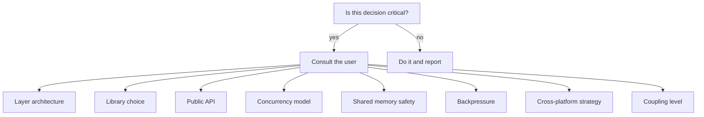
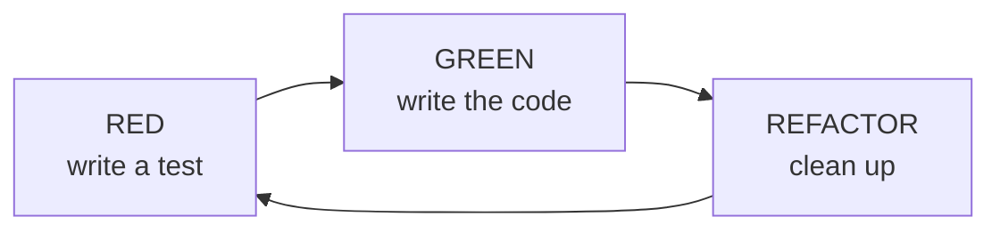
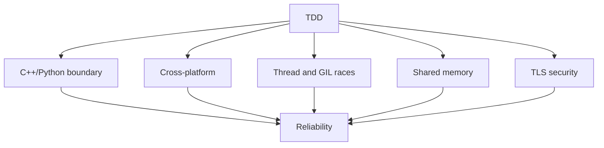

# httpp: Agent Guide

> This file is the guide for an agent (or any developer) working on httpp.
> Language of reports to the user: **Persian**. Everything written inside the repository (code, comments, docs, ADRs, commit messages) is **English**.
> The hard project rules (no system dependencies, `snake_case`, ponytail style, untouched cpp-httplib) are in `handoff.md`
> and [ADR-0014](adr/0014-coding-conventions.md) and are not repeated here.

---

## 1. The golden rule: consult before code

> 🛑 **No critical architectural decision is made without consulting the user.**

But **not every small step needs permission.** When the next priority is clear and not critical, do it and report afterwards.
Report every choice you made, with its reason.

### What counts as "critical"?



### List of critical decisions

Each item below must be decided with the user **before any code is started**:

- [ ] A change to the layer architecture
- [ ] Choosing or replacing a C++ library (and any new dependency: it must be vendored or a submodule)
- [ ] A change to the public Python API
- [ ] A change to the concurrency model (sync/async)
- [ ] The decision about shared memory safety
- [ ] The decision about backpressure
- [ ] The decision about the cross-platform strategy
- [ ] The decision about the coupling level
- [ ] The decision about the level of FastAPI compatibility
- [ ] Anything listed in `Architecture.md`, section 7

### Decisions already made (do not reopen)

Each one is recorded with context and consequences in [docs/adr](adr/README.md).

- **API direction:** a Starlette-like API (with FastAPI on top) implemented **natively** in httpp. httpp replaces FastAPI/Starlette (above) and uvicorn (below), and because both layers are ours we use that for shared memory, declarative work in C++ and getting away from the GIL. An ASGI adapter is only for running **third-party** ASGI apps and has low priority. The exact scope (Starlette-like only, or FastAPI-like as well, pydantic) is still open (`Architecture.md`, risk 4).
- Loop for `async def` handlers: **standard asyncio.** An asyncio loop on Asio and a custom coroutine runner were rejected.
- `--workers`: fresh processes with `SO_REUSEPORT` (Linux only), not `fork`.
- Wheels: one `cp39-abi3` for ordinary Pythons plus a separate wheel for each free-threaded version.
- HTTP/2 and gRPC are out of scope.

### Format of a consultation

When you reach a critical decision, ask like this:

```
⚠️ Critical decision: [title]

Problem:
[description of the problem]

Options:
1. [option 1]: advantage: ... / cost: ...
2. [option 2]: advantage: ... / cost: ...
3. [option 3]: advantage: ... / cost: ...

My suggestion:
[the suggested option and why]

Question:
Which option should we choose?
```

### Before claiming performance

Every speed claim must be reported with its **measurement conditions** (number of cores, handler, client, number of rounds).
A single-core measurement says nothing about multi-core; always write that explicitly.

---

## 2. TDD: tests before code

### The cycle



**Rule:** no line of behavioral code is written without a test. (Documentation and build configuration are exempt.)

If a test is meant to fail for now (such as slowloris before a connection cap exists), mark it explicitly as an
**expected failure**, say so in the report and record it in [ADR-0015](adr/0015-testing-and-ci.md). Do not leave it silent.

### Why TDD is critical for httpp



---

## 3. Test layout

**Today:**

```
tests/
├── cpp/        # utest (tests/utest): engine, server, client, TLS, URL and log tests
├── python/     # pytest; includes test_run.py (CLI, signals, workers) and test_server_features.py
└── utest/      # the C++ test framework (vendored)
```

**Target** (only when needed, without creating empty folders):

```
tests/
├── bench/      # benchmarks
├── fuzz/       # parse surface and our own limits
└── compat/     # only if the FastAPI level (risk 4) turns out to need an ASGI adapter
```

---

## 4. Boundary test (first of all)

### Goal

Measure the cost of crossing Python/C++ **in our own binding** (Cython), and the number of crossings per request.

### Test

To measure an empty call, the binding needs a noop function used only for benchmarks (a small job, to be agreed first).

```python
def test_empty_c_call_overhead():
    """Cost of an empty C++ call from Python: only report it."""
    N = 1_000_000
    start = time.perf_counter()
    for _ in range(N):
        _bench_noop()
    per_call_us = (time.perf_counter() - start) / N * 1e6
    print(f"empty call: {per_call_us:.3f} us")  # record the number; set a threshold only after the baseline is known
```

> The previous version of this document had both `assert < 1.0` and a "target under 0.2"; the two contradicted each other.
> Do not set a fixed threshold until a baseline has been measured.

### Reference numbers (approximate, **not verified**; they must be measured)

| Method | Cost (µs) |
|--------|-----------|
| ctypes | ~1 to 3 |
| cffi ABI | ~1 |
| cffi API | ~0.1 to 0.2 |
| C extension / Cython | ~0.05 to 0.1 |

Comparing ctypes/cffi/pybind11 is only worth it for a paper; the project is on Cython.

---

## 5. Shared memory tests

> ⚠️ The safety decision (risk 2) must be made before starting. **Linux first.**

### Critical tests

```python
import sys
import pytest

linux_only = pytest.mark.skipif(not sys.platform.startswith("linux"), reason="Linux only")
windows_only = pytest.mark.skipif(sys.platform != "win32", reason="Windows only")

def test_cache_set_get():
    app.cache["key"] = b"value"
    assert app.cache["key"] == b"value"

@linux_only
def test_cache_shared_across_workers():
    """5 workers, one cache: one writes, the others read."""

@linux_only
def test_counter_atomic():
    """1000 incr from 5 workers must give 5000 (without shared memory each worker would have 1000)."""

@linux_only
def test_crash_recovery():
    """A worker dies (SIGKILL) while holding a lock: the others must not block and the state must stay intact."""
```

To start the workers, read the same pattern as `tests/python/test_run.py` (`python -m httpp run` processes
with a `PYTHONPATH` computed from `httpp.__file__`).

---

## 6. Compatibility tests

> ⚠️ The exact API scope (risk 4) must be decided with the user before starting.

### Goal

Prove that the native Starlette/FastAPI-like API we built on our own engine really behaves like theirs, by
**running their own tests** on httpp. **No ASGI adapter is needed:** we re-implement the library,
we do not run it on our server.

> The previous version of this section said "FastAPI's tests run without a server, so an ASGI adapter is needed". That is only
> true for running a **ready-made** FastAPI app on httpp and was wrong for our path; it was corrected.

### Method

1. **Starlette first, then FastAPI.** Starlette's test suite is smaller and at framework level (routing, request/response,
   middleware, static files, background tasks, websocket), which is exactly the layer we are building. FastAPI sits on top of it.
2. **Clone the tests in CI at a specific tag**, do not copy them into the repository (licenses: Starlette BSD-3, FastAPI MIT).
   `starlette`, `fastapi`, `httpx` and `pydantic` are only **test dependencies**, not httpp dependencies.
3. Swap the imports with a shim (for example in `conftest.py`: `sys.modules["starlette.applications"] = httpp...`)
   so the tests run unedited.
4. Write an **`httpp.testclient.TestClient`** with the same interface as Starlette's `TestClient` (`get/post/...`, cookies, `websocket_connect`,
   `raise_server_exceptions`). Default mode: a **real server on loopback** (it also exercises our own engine;
   better than Starlette's in-memory mode). Add an in-memory mode later.

### What is hard (know it in advance)

- FastAPI's tests rely on **pydantic** (response_model, validation), `Depends`, `dependency_overrides` and the **OpenAPI JSON schema**.
  To cover those, pydantic becomes an optional dependency of the FastAPI-like layer:
  that is a **critical decision** (choice of library) and must be made with the user.
- The WebSocket tests depend on phase 5.
- Path syntax: FastAPI/Starlette use `{id}`; the C++ router understands only `:id`, and the Python layer converts `{id}` and `<id>`.

### Report a number (from a real run)

```
Starlette test suite @ <tag>:
- PASS: ?   FAIL: ?   SKIP: ?
Every failure: "not planned" / "planned" / "bug"
```

> The compatibility number must come from a real run; the previous version of this document had sample numbers (450/50/90%) which were removed.
> This number is the Evaluation section of the paper.

### Separately: an ASGI adapter (optional, low priority)

Needed only if we want to run a **third-party** ASGI app (for example a real FastAPI app or third-party middleware) on the httpp engine.
It has nothing to do with the path above.

---

## 7. Benchmark tests

```python
def test_benchmark_regression():
    """No PR may be slower than the baseline."""
    baseline = run_benchmark("main")      # build the baseline in the same job on the same machine
    current = run_benchmark("HEAD")
    assert current >= baseline * 0.95
```

### Method (so the number means something)

- **Median of at least 5 rounds**, with warm-up; client and server on separate cores.
- Build the baseline **in the same job**; a stored number from an earlier run on a shared runner fluctuates and makes the test flaky.
- At least 2 cores (multi-core to claim scaling). The current sandbox is single-core; it is only useful for comparing the cost per request.
- Tool: `wrk` or `oha`. Compare with `uvicorn` using `httptools` and `uvloop`.
- Benchmarks run with `log_level="warning"` (the access log of `httpp run` is on by default, see [ADR-0011](adr/0011-logging.md)).

### CI

- Benchmark on every PR, compared with main in the same job; fail if the drop is more than 5%.

---

## 8. Fuzz tests

### What to fuzz

llhttp is fuzzed upstream already; the more valuable target is **our own parse surface and limits**:

- Engine limits (413/414/431), chunked, pipelining, 100-continue
- The router (`:name`), the URL parser, the static file path (path traversal)
- TLS (handshake with random data, a bad certificate) and, in the future, WebSocket (a bad frame, wrong masking)

### Example (parser, with settings initialized properly)

```cpp
extern "C" int LLVMFuzzerTestOneInput(const uint8_t* data, size_t size) {
    llhttp_settings_t settings;
    llhttp_settings_init(&settings);
    llhttp_t parser;
    llhttp_init(&parser, HTTP_REQUEST, &settings);
    llhttp_execute(&parser, reinterpret_cast<const char*>(data), size);
    return 0;
}
```

---

## 9. Security tests

### Slowloris

> Today **there is no connection cap and no header timeout** (risk 7). This test must fail until they exist; mark it
> as an expected failure.

```python
def test_slowloris_resistance():
    """A slow connection must not put the server to sleep."""
    # 1000 connections, each sending 1 byte per second
    # the server must time out and healthy requests must still be answered
```

### Memory and thread safety

- [ ] AddressSanitizer
- [ ] UndefinedBehaviorSanitizer
- [ ] **ThreadSanitizer** (especially important for the server engine, the inbox queue and shared memory)
- [ ] Valgrind (Linux)

---

## 10. Cross-platform tests

CI today (see [ADR-0015](adr/0015-testing-and-ci.md)):

| Job | Linux | macOS | Windows |
|-----|-------|-------|---------|
| Build + C++ tests (`cmake.yml`) | build + `ctest` | build + `ctest` | build only |
| Wheels + Python tests inside each wheel (`wheels.yml`) | yes | yes (universal2) | yes (AMD64 and x86) |

- One `cp39-abi3` wheel runs on every Python 3.9+ and is tested through `cibuildwheel` on the interpreters it installs.
- The free-threaded builds (`3.13t`, `3.14t`, `3.15t`) have their own wheels.
- Everything is green. Platform-specific skips (SIGTERM tests on Windows, multi-worker tests off Linux) are listed in ADR-0015.

---

## 11. Tools

| Tool | Use |
|------|-----|
| **pytest** | Python tests |
| **utest** (vendored in `tests/utest`) | C++ tests |
| **cibuildwheel** | wheel builds |
| **uv** | building a free-threaded interpreter and local wheels (`uv python install 3.14t`) |
| **ASan / UBSan / TSan** | memory and thread safety |
| **libFuzzer** | fuzzing |
| **perf / py-spy** | profiling |
| **wrk / oha** | benchmarks |

---

## 12. Definition of Done

A task is done when:

- [ ] The test was written before the code and **all** tests pass: C++ (`build/tests/cpp/test_httpp_cpp`) and Python (`pytest tests/python`), and also on a free-threaded interpreter if it concerns thread/GIL behavior.
- [ ] No system dependency was added; a new dependency is vendored or a submodule.
- [ ] Naming is `snake_case`; every deliberate simplification is marked with `ponytail:` and an upgrade path; inputs are validated.
- [ ] `cpp-httplib` is untouched (`httplib.h` is exactly v0.54.1).
- [ ] If behavior changed, the README, `CHANGELOG.md` and the relevant ADR are updated.
- [ ] If a performance claim was made, it is recorded with its measurement conditions and limits.
- [ ] Critical decisions were made with the user and other choices were reported with reasons.
- [ ] Everything written in the repository is in English and contains no em dash character.
- [ ] A short report in Persian: what was done, which tests, what is still not done, honest limits.
- [ ] The whole project (without `build*/`, `.git`, `__pycache__`) is zipped and sent.
