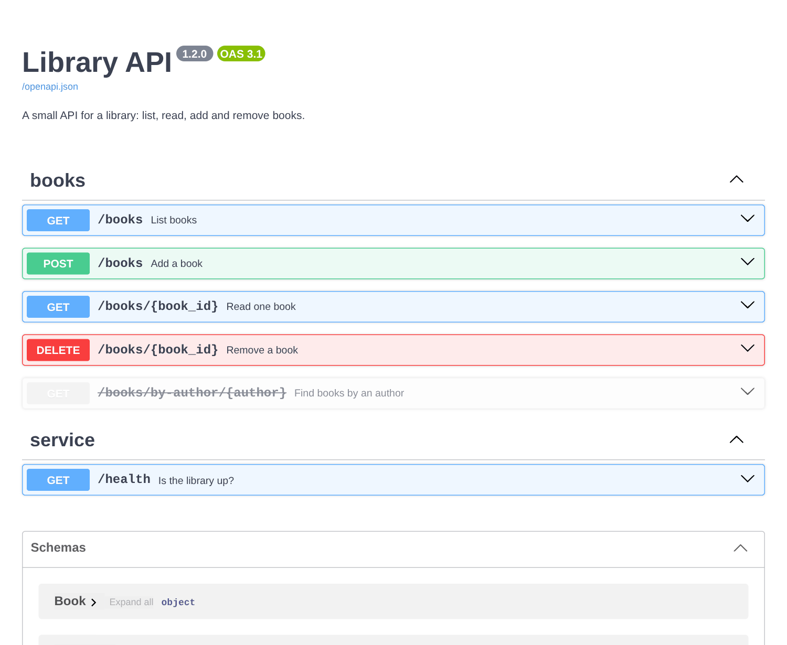
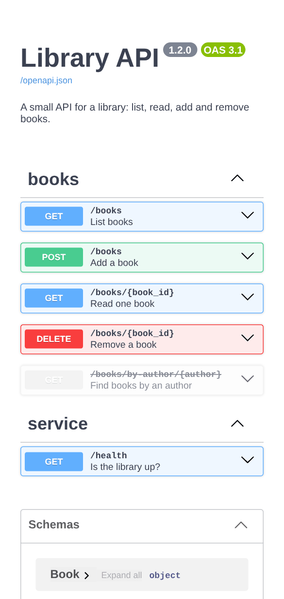

A Python `Server` describes its own routes and serves a page where you can read them and try them out. The page is Swagger UI, and it is built into httpp, so it loads without internet and there is nothing to install. The routes, their parameters and their models come from your type hints; there is no second file to keep up to date.

## A small API

This is the API in every picture on this page.

```python
from typing import List, Optional

from httpp import HTTPException, Query, Server
from httpp.models import BaseModel, Field

app = Server(
    title="Library API",
    version="1.2.0",
    description="A small API for a library: list, read, add and remove books.",
)


class BookIn(BaseModel):
    title: str = Field(min_length=1, max_length=120, description="The title of the book.", examples=["The Pragmatic Programmer"])
    author: str = Field(min_length=1, description="Who wrote it.", examples=["Andrew Hunt"])
    year: int = Field(ge=1450, le=2100, description="The year it was first published.", examples=[1999])
    tags: List[str] = Field(default_factory=list, description="Free words to find it by.", examples=[["software", "craft"]])


class Book(BookIn):
    id: int


BOOKS = {
    1: Book(id=1, title="The Pragmatic Programmer", author="Andrew Hunt", year=1999, tags=["software", "craft"]),
    2: Book(id=2, title="Structure and Interpretation of Computer Programs", author="Harold Abelson", year=1985, tags=["software", "lisp"]),
    3: Book(id=3, title="A Philosophy of Software Design", author="John Ousterhout", year=2018, tags=["software", "design"]),
}


@app.get("/books", tags=["books"], summary="List books", response_model=List[Book])
def list_books(
    q: Optional[str] = Query(None, description="Only books whose title contains this text."),
    limit: int = Query(10, ge=1, le=100, description="How many books to return at most."),
):
    """The books in the library, oldest id first."""
    found = [b for b in BOOKS.values() if q is None or q.lower() in b.title.lower()]
    return found[:limit]


@app.get("/books/{book_id}", tags=["books"], summary="Read one book", response_model=Book)
def read_book(book_id: int):
    """One book by its id. Answers 404 when there is none."""
    if book_id not in BOOKS:
        raise HTTPException(404, "no such book")
    return BOOKS[book_id]


@app.post("/books", tags=["books"], summary="Add a book", response_model=Book, status_code=201)
def add_book(book: BookIn):
    """Add a book. The id is chosen by the library."""
    new_id = max(BOOKS) + 1
    BOOKS[new_id] = Book(id=new_id, **book.model_dump())
    return BOOKS[new_id]


@app.delete("/books/{book_id}", tags=["books"], summary="Remove a book", status_code=204)
def remove_book(book_id: int):
    if BOOKS.pop(book_id, None) is None:
        raise HTTPException(404, "no such book")


@app.get("/books/by-author/{author}", tags=["books"], summary="Find books by an author", deprecated=True)
def by_author(author: str):
    """Use `GET /books?q=` instead."""
    return [b for b in BOOKS.values() if author.lower() in b.author.lower()]


@app.get("/health", tags=["service"], summary="Is the library up?")
def health():
    return {"status": "ok"}


if __name__ == "__main__":
    app.listen("127.0.0.1", 8200)
```

Run it and open `http://127.0.0.1:8200/docs`. The same server answers `/openapi.json`, the OpenAPI 3.1 document the page reads.

## The page



The title, version and description at the top are the arguments of `Server`. Routes are grouped by `tags`, and each line shows the method, the path and the `summary`. A route marked `deprecated=True` is struck through, as the by-author route is here, and it still works. A route with `include_in_schema=False` is left out, and so are `/docs` and `/openapi.json` themselves.

## What an operation shows

A click on a line opens it. The text under the line is the docstring of the function.


Parameters come from the arguments of the function. A name that is in the path is a path parameter, the other simple arguments are query parameters, and one that has a default or is `Optional` is not marked as required. `Query(..., description=...)` adds the text next to a parameter.

A model argument becomes the request body, and its example is built from the `examples` of the fields.


The documented answers are the success status, which is `status_code` (200 if you give none) with the schema of `response_model`, and `422`, the answer for a request that does not fit its parameters or its body.

## Try it out

**Try it out** turns the parameters into fields, **Execute** sends a real request from your browser to your server, and the page shows what came back, with the `curl` command that does the same.


A 404 that your function raises with `HTTPException` works as well. Swagger UI labels it _Undocumented_, because only the success status and `422` are described for you.


The page also checks the limits of a parameter by itself. With `limit=500` it shows _Value must be less than or equal to 100_ and sends nothing, so to see the server's own `422`, send a body that breaks a rule of the model. Here the title is empty and the year is before 1450:


Each error says the `type`, where it is (`loc`), a `msg`, the `input` that was refused and the limit that it broke (`ctx`). This is the shape that `HTTPValidationError` describes in the document.

## The models

The **Schemas** section lists the models, and the rules of the fields show up in it: the length of `title`, the range of `year`, the descriptions and the examples.


## On a phone

<div style={{maxWidth: 300}}>



</div>

## Settings

| Where | Option | Meaning |
|---|---|---|
| `Server(...)` | `title`, `version`, `description` | the header of the page and of the document (`"httpp"`, `"0.1.0"` and none by default) |
| `Server(...)` | `docs_url` | where the page is (`"/docs"`); `None` removes the page and keeps the document |
| `Server(...)` | `openapi_url` | where the document is (`"/openapi.json"`); `None` removes both |
| a route | `summary`, `description`, `tags` | the line, the text and the group (the description is the docstring if you give none) |
| a route | `deprecated`, `include_in_schema` | strike the route through, or leave it out |
| a route | `status_code`, `response_model` | the documented success answer, and the model that the returned value is checked against |

`app.openapi()` returns the document as a dict. It is built the first time it is asked for and built again when a route is added after that.

To move the page, give both addresses: `Server(docs_url="/api/docs", openapi_url="/api/openapi.json")`. The page then reads its document from the new address.

## In C++

C++ has the page but not the generator. `httpp::swagger_ui` serves the same Swagger UI from files compiled into the library, and you serve the OpenAPI document yourself, written by hand or read from a file. The header is not part of `httpp.h`.

```cpp
#include <httpp.h>
#include <httpp/swagger_ui.hpp>  // not part of httpp.h

int main() {
    httpp::server app;

    app.get("/hello/{name}", [](const httpp::server_request& req, httpp::response& res) {
        res.json("{\"hello\":\"" + std::string(req.path_param("name")) + "\"}");
    });

    app.get("/openapi.json", [](const httpp::server_request&, httpp::response& res) {
        res.json(R"({
  "openapi": "3.1.0",
  "info": {"title": "Hello API", "version": "1.0.0"},
  "paths": {
    "/hello/{name}": {
      "get": {
        "summary": "Say hello",
        "parameters": [{"name": "name", "in": "path", "required": true, "schema": {"type": "string"}}],
        "responses": {"200": {"description": "A greeting"}}
      }
    }
  }
})");
    });

    httpp::swagger_ui().set_docs_path("/docs").set_openapi_url("/openapi.json").set_title("Hello API").mount(app);

    app.listen("127.0.0.1", 8201);
}
```

`set_docs_path` takes a path that starts with `/` and names more than the root, or it throws `std::invalid_argument`. The page is at that path, and its three files are under it. The Python class `httpp.SwaggerUI` does the same for a document of your own: `httpp.SwaggerUI(docs_path="/docs", title="Mine").mount(app)`.

## Before you publish it

`/docs` and `/openapi.json` have no login, and they list every route that is not left out with `include_in_schema=False`. Anyone who can reach your server can read them, and can use **Try it out** on any route that does not ask for a key itself. For a server that is open to the internet, turn the page off with `docs_url=None`, or the document too with `openapi_url=None`.
