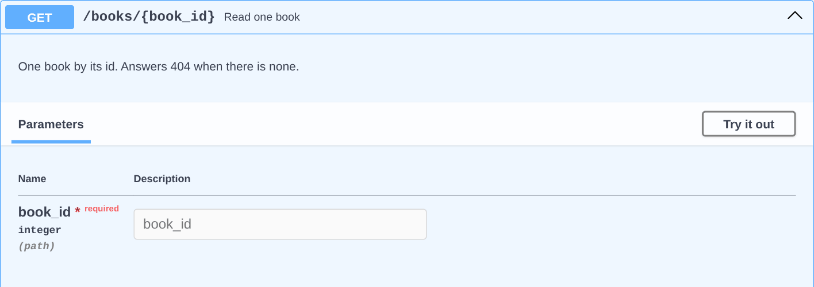
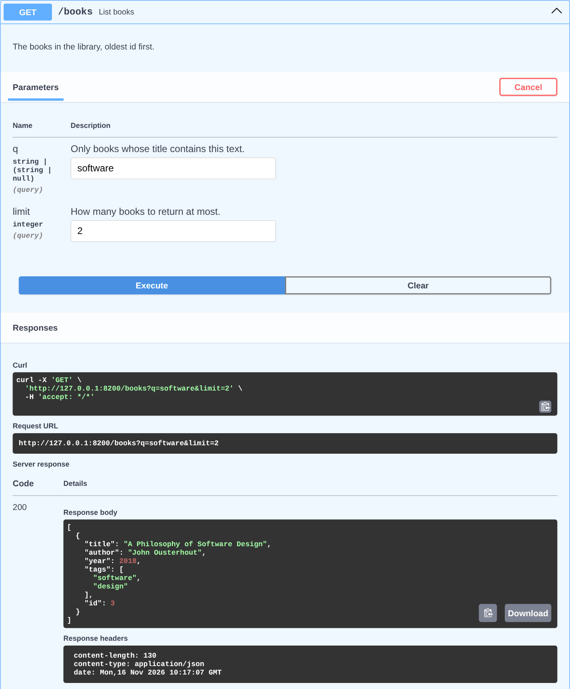
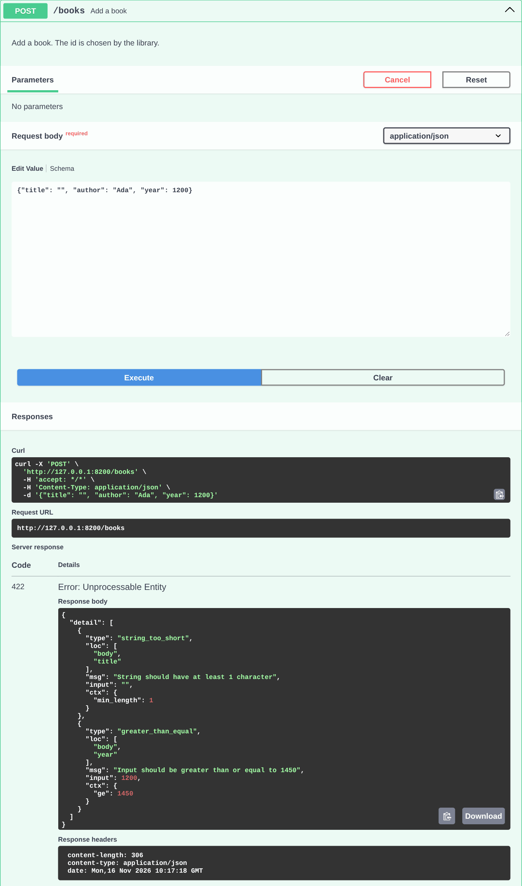
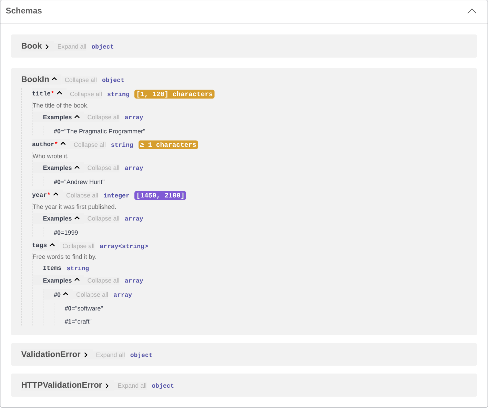

A Python `Server` describes its own routes and serves a page where you can read them and try them out. The page is Swagger UI, and it is built into httpp, so it loads without internet and there is nothing to install. The routes, their parameters and their models come from your type hints; there is no second file to keep up to date.

## A small API

This is the API in every picture on this page.

```python
from typing import List, Optional

from httpp import HTTPException, Query, Server
from httpp.models import BaseModel, Field

app = Server(
    title="Library API",
    version="1.2.0",
    description="A small API for a library: list, read, add and remove books.",
)


class BookIn(BaseModel):
    title: str = Field(min_length=1, max_length=120, description="The title of the book.", examples=["The Pragmatic Programmer"])
    author: str = Field(min_length=1, description="Who wrote it.", examples=["Andrew Hunt"])
    year: int = Field(ge=1450, le=2100, description="The year it was first published.", examples=[1999])
    tags: List[str] = Field(default_factory=list, description="Free words to find it by.", examples=[["software", "craft"]])


class Book(BookIn):
    id: int


BOOKS = {
    1: Book(id=1, title="The Pragmatic Programmer", author="Andrew Hunt", year=1999, tags=["software", "craft"]),
    2: Book(id=2, title="Structure and Interpretation of Computer Programs", author="Harold Abelson", year=1985, tags=["software", "lisp"]),
    3: Book(id=3, title="A Philosophy of Software Design", author="John Ousterhout", year=2018, tags=["software", "design"]),
}


@app.get("/books", tags=["books"], summary="List books", response_model=List[Book])
def list_books(
    q: Optional[str] = Query(None, description="Only books whose title contains this text."),
    limit: int = Query(10, ge=1, le=100, description="How many books to return at most."),
):
    """The books in the library, oldest id first."""
    found = [b for b in BOOKS.values() if q is None or q.lower() in b.title.lower()]
    return found[:limit]


@app.get("/books/{book_id}", tags=["books"], summary="Read one book", response_model=Book)
def read_book(book_id: int):
    """One book by its id. Answers 404 when there is none."""
    if book_id not in BOOKS:
        raise HTTPException(404, "no such book")
    return BOOKS[book_id]


@app.post("/books", tags=["books"], summary="Add a book", response_model=Book, status_code=201)
def add_book(book: BookIn):
    """Add a book. The id is chosen by the library."""
    new_id = max(BOOKS) + 1
    BOOKS[new_id] = Book(id=new_id, **book.model_dump())
    return BOOKS[new_id]


@app.delete("/books/{book_id}", tags=["books"], summary="Remove a book", status_code=204)
def remove_book(book_id: int):
    if BOOKS.pop(book_id, None) is None:
        raise HTTPException(404, "no such book")


@app.get("/books/by-author/{author}", tags=["books"], summary="Find books by an author", deprecated=True)
def by_author(author: str):
    """Use `GET /books?q=` instead."""
    return [b for b in BOOKS.values() if author.lower() in b.author.lower()]


@app.get("/health", tags=["service"], summary="Is the library up?")
def health():
    return {"status": "ok"}


if __name__ == "__main__":
    app.listen("127.0.0.1", 8200)
```

Run it and open `http://127.0.0.1:8200/docs`. The same server answers `/openapi.json`, the OpenAPI 3.1 document the page reads.

## The page


The title, version and description at the top are the arguments of `Server`. Routes are grouped by `tags`, and each line shows the method, the path and the `summary`. A route marked `deprecated=True` is struck through, as the by-author route is here, and it still works. A route with `include_in_schema=False` is left out, and so are `/docs` and `/openapi.json` themselves.

## What an operation shows

A click on a line opens it. The text under the line is the docstring of the function.



Parameters come from the arguments of the function. A name that is in the path is a path parameter, the other simple arguments are query parameters, and one that has a default or is `Optional` is not marked as required. `Query(..., description=...)` adds the text next to a parameter.

A model argument becomes the request body, and its example is built from the `examples` of the fields.


The documented answers are the success status, which is `status_code` (200 if you give none) with the schema of `response_model`, and `422`, the answer for a request that does not fit its parameters or its body.

## Try it out

**Try it out** turns the parameters into fields, **Execute** sends a real request from your browser to your server, and the page shows what came back, with the `curl` command that does the same.



A 404 that your function raises with `HTTPException` works as well. Swagger UI labels it _Undocumented_, because only the success status and `422` are described for you.


The page also checks the limits of a parameter by itself. With `limit=500` it shows _Value must be less than or equal to 100_ and sends nothing, so to see the server's own `422`, send a body that breaks a rule of the model. Here the title is empty and the year is before 1450:



Each error says the `type`, where it is (`loc`), a `msg`, the `input` that was refused and the limit that it broke (`ctx`). This is the shape that `HTTPValidationError` describes in the document.

## Authorize

Declare how the API is protected and Swagger UI shows an **Authorize** button and a lock on the operations that need it, so **Try it out** can send the credentials:

```python
from httpp import Server, security

app = Server(security_schemes={"basic": security.basic(), "jwt": security.bearer("JWT")}, security=["jwt"])

@app.get("/admin", security=["basic"])   # needs Basic credentials
def admin(): ...

@app.get("/health", security=[])         # public, although the default asks for a JWT
def health(): ...
```

`security.basic()`, `security.bearer()` and `security.api_key(name, "header" | "query" | "cookie")` write the scheme objects. `Server(security=...)` is the requirement of every route, a route's `security=` replaces it (`[]` makes it public), and `APIRouter(security=...)` is the default of that router's routes. A list means any one of them; a dict `{"basic": [], "key": []}` means both together. A name that was not declared raises `ValueError` where the route is written.

This only describes the API. Nothing is checked because of it: add `BasicAuthMiddleware`, or read `request.basic_auth()` or the `Authorization` header in a dependency, and verify a token with a library of your choice. A document that says a route is open while a middleware refuses it is a lie you can test for: call the route without credentials and expect `401`.

## The models

The **Schemas** section lists the models, and the rules of the fields show up in it: the length of `title`, the range of `year`, the descriptions and the examples.



## On a phone

<div style={{maxWidth: 300}}>


</div>

## Settings

| Where | Option | Meaning |
|---|---|---|
| `Server(...)` | `title`, `version`, `description` | the header of the page and of the document (`"httpp"`, `"0.1.0"` and none by default) |
| `Server(...)` | `docs_url` | where the page is (`"/docs"`); `None` removes the page and keeps the document |
| `Server(...)` | `openapi_url` | where the document is (`"/openapi.json"`); `None` removes both |
| a route | `summary`, `description`, `tags` | the line, the text and the group (the description is the docstring if you give none) |
| a route | `deprecated`, `include_in_schema` | strike the route through, or leave it out |
| a route | `status_code`, `response_model` | the documented success answer, and the model that the returned value is checked against |

`app.openapi()` returns the document as a dict. It is built the first time it is asked for and built again when a route is added after that.

To move the page, give both addresses: `Server(docs_url="/api/docs", openapi_url="/api/openapi.json")`. The page then reads its document from the new address.

## In C++

C++ has the page and a writer for the document, but it does not make the document from your routes. `httpp::swagger` serves the same Swagger UI from files compiled into the library, and `httpp::openapi::document` turns what you describe into correct JSON text: every string escaped, the paths grouped, every security name checked. Nothing in it reads JSON, so there is no parser. The headers are not part of `httpp.h`.

```cpp
#include <httpp.h>
#include <httpp/openapi.hpp>     // not part of httpp.h
#include <httpp/swagger.hpp>  // not part of httpp.h

int main() {
    httpp::server app;
    namespace oa = httpp::openapi;

    app.get("/hello/{name}", [](const httpp::server_request& req, httpp::response& res) {
        res.json("{\"hello\":\"" + std::string(req.path_param("name")) + "\"}");
    });
    app.get("/health", [](const httpp::server_request&, httpp::response& res) { res.json("{\"ok\":true}"); });

    oa::document doc("Hello API", "1.0.0");
    doc.security_scheme("jwt", oa::bearer("JWT"));
    doc.security(oa::any_of({"jwt"}));                       // the default of every operation

    doc.get("/hello/{name}")
        .summary("Say hello")
        .parameter("name", "path", true)
        .response(200, "A greeting");
    doc.get("/health").no_security().response(200, "OK");   // public although the default asks for a JWT

    app.get("/openapi.json", [&doc](const httpp::server_request&, httpp::response& res) { res.json(doc.to_json()); });
    httpp::swagger("/openapi.json").set_title("Hello API").mount(app, "/docs");

    app.listen("127.0.0.1", 8201);
}
```

You describe the API apart from the handlers, so the document can drift from them: add a route and forget the line in `doc`, and the page does not show it. Python builds its document from the routes themselves and cannot drift; C++ has no way to read a handler's arguments, so it does not try. Like in Python, security here is only documentation for the **Authorize** button: nothing is checked because of it.

`scheme` objects come from `basic()`, `bearer(format)`, `api_key(name, "header" | "query" | "cookie")` and `raw_scheme(json)` (OAuth2 and the rest). A requirement is a list: `any_of({"basic", "jwt"})` means any one of them, and a `requirement` with several names in it means all of them together. A name that was not declared throws `std::invalid_argument` from `to_json()`, and the message names the operation.

Where a schema or a body is more than a few fields, give it as JSON text: `parameter(name, in, required, schema_json)`, `request_body(json)`, `response(status, description, content_json)`, `component_schema(name, json)` and `raw(key, json)` for any other key. The text is put in as it is. It is not parsed, so it being valid JSON is your promise; only text that is blank or not UTF-8 is refused.

`httpp::swagger` takes the address of the OpenAPI document in its constructor. It is required, because the library does not serve that document: you do, on that address. The address is used as it is, so when you mount the page under another base, give the whole address. `mount(app, base)` puts the page at `base` and its three files under it; `base` defaults to `"/docs"`, must start with `/` and name more than the root, or `mount` throws `std::invalid_argument`. One `swagger` object can be mounted more than once.

Python has the same writer: `httpp.openapi.Document("Hello API", "1.0.0")`, with the same calls (`security_scheme`, `security`, `add(method, path, ...)`, `to_json()`). `Server.openapi()` is written through it. The Python class `httpp.Swagger` does the page for a document of your own: `httpp.Swagger("/openapi.json", title="Mine").mount(app, "/docs")`.

## Before you publish it

`/docs` and `/openapi.json` have no login, and they list every route that is not left out with `include_in_schema=False`. Anyone who can reach your server can read them, and can use **Try it out** on any route that does not ask for a key itself. For a server that is open to the internet, turn the page off with `docs_url=None`, or the document too with `openapi_url=None`.
