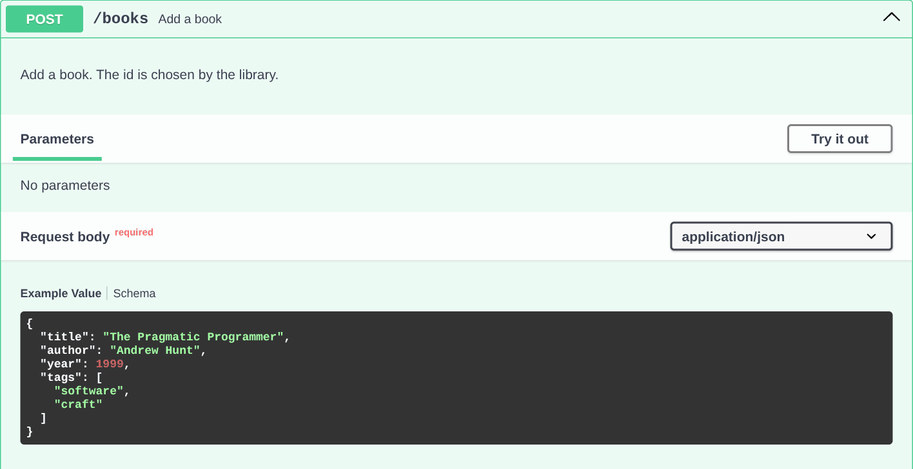
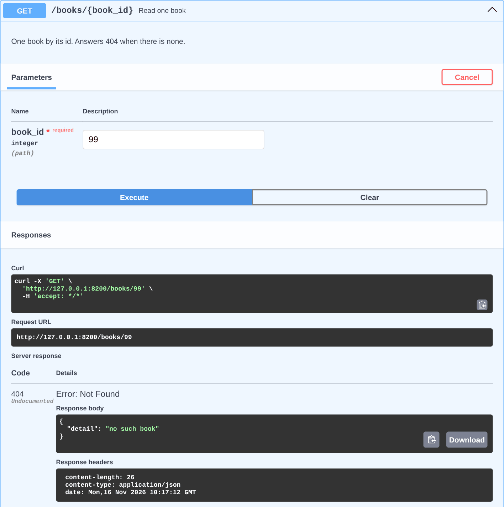

import Lang from '@site/src/components/Lang';
import Only from '@site/src/components/Only';
import Grid from '@site/src/components/Grid';

<Only lang="python">

A Python `Server` describes its own routes and serves a page where you can read them and try them out. The page is Swagger UI, and it is built into httpp, so it loads without internet and there is nothing to install. The routes, their parameters and their models come from your type hints; there is no second file to keep up to date.

</Only>

<Only lang="cpp">

httpp serves the Swagger UI page in C++ too. It is built into the library, so it loads without internet and there is nothing to install. What C++ cannot do is read your handlers, so you describe the API next to them and `httpp::openapi::document` turns that description into the OpenAPI document the page reads. Python builds the same document from the routes themselves; switch to Python in the top bar to see that.

</Only>

## A small API

Two routes, the Swagger UI page at `/docs` and the OpenAPI document at `/openapi.json`, with the document **written by hand**. Python and C++ both do this. In C++ the two headers `httpp/openapi.hpp` and `httpp/swagger.hpp` are not part of `httpp.h`.

<Lang name="swagger" />

<Only lang="cpp">

C++ has the page and a writer for the document, but it does not make the document from your routes. `httpp::swagger` serves the same Swagger UI from files compiled into the library, and `httpp::openapi::document` turns what you describe into correct JSON text: every string escaped, the paths grouped, every security name checked. Nothing in it reads JSON, so there is no parser.

</Only>

<Only lang="python">

`httpp.openapi.Document` is the writer that `Server.openapi()` uses, and `httpp.Swagger` serves the page for a document of your own. `doc.add(method, path, ...)` takes `summary`, `description`, `parameters`, `request_body`, `responses`, `security` and `extra` for any other key of the operation object. `security=None` leaves the default of the document, a list sets this operation's requirements, and `[]` makes it public.

</Only>

You describe the API apart from the handlers, so the document can drift from them: add a route and forget the line in `doc`, and the page does not show it. Security here is only documentation for the **Authorize** button: nothing is checked because of it.

<Only lang="python">

**In Python the document can write itself.** A `Server` writes the document from its routes, the type hints and the models, so it cannot drift.

</Only>

<Only lang="cpp">

**In C++ you write the whole document**, and a bigger API is only more of the same lines: the models as JSON text, and one `doc.get(...)` for each route. The example below is a library with books. The Python page has the same API, and the document of both is the same, so the pictures on this page are the same for both languages.

</Only>

This is the API in every picture on this page:

<Lang name="swagger" file="auto_document" />

Run it and open `http://127.0.0.1:8000/docs`. The same server answers `/openapi.json`, the OpenAPI 3.1 document the page reads.

## The page


<Only lang="python">

The title, version and description at the top are the arguments of `Server`. Routes are grouped by `tags`, and each line shows the method, the path and the `summary`. A route marked `deprecated=True` is struck through, as the by-author route is here, and it still works. A route with `include_in_schema=False` is left out, and so are `/docs` and `/openapi.json` themselves.

</Only>

<Only lang="cpp">

The title, version and description at the top are the arguments of `oa::document` and its `description()`. Routes are grouped by `tag()`, and each line shows the method, the path and the `summary`. A route marked `deprecated()` is struck through, as the by-author route is here, and it still works. A route that is not in the document is not on the page. The page is the same Swagger UI that Python serves. `mount` puts it at the base you give and answers there; the document it reads is the one you serve at the address you gave to `httpp::swagger`.

</Only>


## What an operation shows

A click on a line opens it. The text under the line is the `description` of the operation (in Python, the docstring of the function).


<Only lang="python">

Parameters come from the arguments of the function. A name that is in the path is a path parameter, the other simple arguments are query parameters, and one that has a default or is `Optional` is not marked as required. `Query(..., description=...)` adds the text next to a parameter.

A model argument becomes the request body, and its example is built from the `examples` of the fields.

</Only>

<Only lang="cpp">

A parameter is `parameter(name, in, required, schema_json, description)`: `in` is `"path"`, `"query"`, `"header"` or `"cookie"`, and the schema carries the type, the limits and the default.

The request body is `request_body(json)`, and its example is built from the `examples` of the fields of the schema it points to.

</Only>



<Only lang="python">

The documented answers are the success status, which is `status_code` (200 if you give none) with the schema of `response_model`, and `422`, the answer for a request that does not fit its parameters or its body.

</Only>

<Only lang="cpp">

The answers are the ones you give to `response(status, description, content_json)`: here the success status and `422`, as in Python.

Each `doc.get(path)` (or `post`, `put`, `delete`) is one operation. Its `summary`, `parameter(name, in, required)` and `response(status, description)` are what the page shows for it, and the order of the calls is the order of the lines.

Where a schema or a body is more than a few fields, give it as JSON text: `parameter(name, in, required, schema_json)`, `request_body(json)`, `response(status, description, content_json)`, `component_schema(name, json)` and `raw(key, json)` for any other key. The text is put in as it is. It is not parsed, so it being valid JSON is your promise; only text that is blank or not UTF-8 is refused.

</Only>


## Try it out

**Try it out** turns the parameters into fields, **Execute** sends a real request from your browser to your server, and the page shows what came back, with the `curl` command that does the same. A route that you did not describe is not on the page, so there is nothing to try.


A 404 that your handler raises (`HTTPException` in Python, `httpp::http_exception` in C++) works as well. Swagger UI labels it _Undocumented_, because only the success status and `422` are described.



<Only lang="python">

The page also checks the limits of a parameter by itself. With `limit=500` it shows _Value must be less than or equal to 100_ and sends nothing, so to see the server's own `422`, send a body that breaks a rule of the model. Here the title is empty and the year is before 1450:


Each error says the `type`, where it is (`loc`), a `msg`, the `input` that was refused and the limit that it broke (`ctx`). This is the shape that `HTTPValidationError` describes in the document.

</Only>

<Only lang="cpp">

The page also checks the limits of a parameter by itself: with `limit=500` it shows _Value must be less than or equal to 100_ and sends nothing. The `422` of a body that breaks a rule of the model is not made for you in C++: the library does not read JSON, so the handler reads the body with the library you use and answers `422` in the shape it likes. The picture of that answer on the Python page shows the shape that `HTTPValidationError` describes.

</Only>


## Authorize

<Only lang="python">

Declare how the API is protected and Swagger UI shows an **Authorize** button and a lock on the operations that need it, so **Try it out** can send the credentials:

```python
from httpp import Server, security

app = Server(security_schemes={"basic": security.basic(), "jwt": security.bearer("JWT")}, security=["jwt"])

@app.get("/admin", security=["basic"])   # needs Basic credentials
def admin(): ...

@app.get("/health", security=[])         # public, although the default asks for a JWT
def health(): ...
```

`security.basic()`, `security.bearer()` and `security.api_key(name, "header" | "query" | "cookie")` write the scheme objects. `Server(security=...)` is the requirement of every route, a route's `security=` replaces it (`[]` makes it public), and `APIRouter(security=...)` is the default of that router's routes. A list means any one of them; a dict `{"basic": [], "key": []}` means both together. A name that was not declared raises `ValueError` where the route is written.

This only describes the API. Nothing is checked because of it: add `BasicAuthMiddleware`, or read `request.basic_auth()` or the `Authorization` header in a dependency, and verify a token with a library of your choice. A document that says a route is open while a middleware refuses it is a lie you can test for: call the route without credentials and expect `401`.

</Only>

<Only lang="cpp">

`scheme` objects come from `basic()`, `bearer(format)`, `api_key(name, "header" | "query" | "cookie")` and `raw_scheme(json)` (OAuth2 and the rest). A requirement is a list: `any_of({"basic", "jwt"})` means any one of them, and a `requirement` with several names in it means all of them together. A name that was not declared throws `std::invalid_argument` from `to_json()`, and the message names the operation.

</Only>


## The models

The **Schemas** section lists the models, and the rules of the fields show up in it: the length of `title`, the range of `year`, the descriptions and the examples.


<Only lang="python">

The models are your classes: `Field(min_length=1, max_length=120, ...)` is what writes the limits.

</Only>

<Only lang="cpp">

`component_schema(name, json)` adds a model to the **Schemas** section. The JSON text is put in as it is, so the rules of its fields show up there only if you wrote them.

</Only>


## On a phone

<div style={{maxWidth: 300}}>


</div>


## Settings

<Only lang="python">

<Grid
  head={['Where', 'Option', 'Meaning']}
  rows={[
    ['`Server(...)`', '`title`, `version`, `description`', 'the header of the page and of the document (`"httpp"`, `"0.1.0"` and none by default)'],
    ['`Server(...)`', '`docs_url`', 'where the page is (`"/docs"`); `None` removes the page and keeps the document'],
    ['`Server(...)`', '`openapi_url`', 'where the document is (`"/openapi.json"`); `None` removes both'],
    ['a route', '`summary`, `description`, `tags`', 'the line, the text and the group (the description is the docstring if you give none)'],
    ['a route', '`deprecated`, `include_in_schema`', 'strike the route through, or leave it out'],
    ['a route', '`status_code`, `response_model`', 'the documented success answer, and the model that the returned value is checked against'],
  ]}
/>

`app.openapi()` returns the document as a dict. It is built the first time it is asked for and built again when a route is added after that.

To move the page, give both addresses: `Server(docs_url="/api/docs", openapi_url="/api/openapi.json")`. The page then reads its document from the new address.

</Only>

<Only lang="cpp">

`httpp::swagger` takes the address of the OpenAPI document in its constructor. It is required, because the library does not serve that document: you do, on that address. The address is used as it is, so when you mount the page under another base, give the whole address. `mount(app, base)` puts the page at `base` and its three files under it; `base` defaults to `"/docs"`, must start with `/` and name more than the root, or `mount` throws `std::invalid_argument`. One `swagger` object can be mounted more than once.

</Only>


## Before you publish it

<Only lang="python">

`/docs` and `/openapi.json` have no login, and they list every route that is not left out with `include_in_schema=False`. Anyone who can reach your server can read them, and can use **Try it out** on any route that does not ask for a key itself. For a server that is open to the internet, turn the page off with `docs_url=None`, or the document too with `openapi_url=None`.

</Only>

<Only lang="cpp">

`/docs` and `/openapi.json` have no login, and they list every operation that you described. Anyone who can reach your server can read them, and can use **Try it out** on any route that does not ask for a key itself. For a server that is open to the internet, do not mount the page: leave out the `httpp::swagger(...).mount(...)` line, and the route that serves the document too.

</Only>
